# BÁO CÁO TỔNG HỢP KIỂM THỬ GUI & USABILITY (MAIN REPORT)
## MÔN HỌC: KIỂM CHỨNG PHẦN MỀM (CS423 / CSC13003) — HỌC KỲ 1/2026

---

### THÔNG TIN CHUNG
- **Mã bài tập:** HW03-AI – GUI & Usability Testing
- **Họ và tên sinh viên:** VĂN ĐỨC TUẤN
- **Mã số sinh viên (MSSV):** 23120397
- **Lớp / Khóa:** Kiểm thử phần mềm - CQ2023/3
- **Hệ thống kiểm thử (SUT):** EShop ([https://github.com/ttbhanh/eshop-sut](https://github.com/ttbhanh/eshop-sut))
- **Ngày thực hiện:** 08/11/2026
- **Công cụ hỗ trợ:** Antigravity (Gemini 3.8 Flash / Google DeepMind)

---

## MỤC LỤC
1. [Phạm vi Kiểm thử (Scope Selection)](#1-phạm-vi-kiểm-thử-scope-selection)
2. [Task 1: Thiết kế & Thực thi GUI Checklist (30 Điểm)](#2-task-1-thiết-kế--thực-thi-gui-checklist-30-điểm)
   - 2.1. Thiết kế GUI Checklist (> 40 Items bao phủ IA-01 → IA-04)
   - 2.2. Human Review & Phản biện các điểm AI bỏ sót
   - 2.3. Kết quả Thực thi Checklist (Test Execution)
   - 2.4. Danh sách Báo cáo Lỗi (Bug Report & GitHub Issues)
3. [Task 2: Đánh giá Usability (Usability Evaluation - 40 Điểm)](#3-task-2-đánh-giá-usability-usability-evaluation---40-điểm)
   - 3.1. Mục tiêu & Kịch bản thực nghiệm (Task Scenario)
   - 3.2. Thiết kế Thang đo (SUS / UEQ-S Questionnaire)
   - 3.3. Nhật ký & Dữ liệu 7 Người tham gia khảo sát (7 Sessions)
   - 3.4. Phân tích kết quả, Friction Points & Mức độ nghiêm trọng
4. [Task 3: Kiểm thử Đa Trình duyệt & Đa Nền tảng (Cross-Browser / Platform - 20 Điểm)](#4-task-3-kiểm-thử-đa-trình-duyệt--đa-nền-tảng-cross-browser--platform---20-điểm)
   - 4.1. Môi trường kiểm thử (Chrome, Firefox, Safari/Mobile)
   - 4.2. Ma trận kết quả tương thích
   - 4.3. Bằng chứng kiểm thử có Watermark thông tin sinh viên
5. [Task 4: Xây dựng & Tự động hóa với Agent Skill (10 Điểm)](#5-task-4-xây-dựng--tự-động-hóa-với-agent-skill-10-điểm)
   - 5.1. Cấu trúc và nguyên lý hoạt động của Skill
   - 5.2. Video minh chứng thực nghiệm End-to-End (YouTube Link)
6. [Đánh giá Phản biện AI (AI Critique - 200–300 Từ)](#6-đánh-giá-phản-biện-ai-ai-critique---200300-từ)
7. [Bảng Tự Đánh Giá Điểm (Self-Assessment Rubric)](#7-bảng-tự-đánh-giá-điểm-self-assessment-rubric)

---

## 1. Phạm vi Kiểm thử (Scope Selection)

### 1.1. Lựa chọn Màn hình cho Task 1 (GUI Checklist)
Theo lựa chọn của sinh viên từ **Pool C — Web Admin** trong tài liệu đặc tả bài tập HW03, bộ tiêu chí kiểm thử giao diện tập trung toàn diện vào 4 phân hệ cốt lõi:
- **FR-13: Dashboard (Bảng điều khiển & Thống kê tổng quan):** Hiển thị tổng doanh thu các đơn hàng thành công (`delivered`), tổng số lượng đơn hàng, biểu đồ và bố cục thẻ chỉ số (KPI cards).
- **FR-14: Category management (Quản lý Danh mục - CRUD):** Form thêm mới danh mục, bảng danh sách phân cấp danh mục, thao tác chỉnh sửa và xóa danh mục.
- **FR-15: Product management (Quản lý Sản phẩm - CRUD & Import CSV):** Form thêm/sửa sản phẩm (tên, giá tiền, hình ảnh URL, mô tả, phân loại danh mục), bảng hiển thị danh sách sản phẩm kèm thumbnail và chức năng Import sản phẩm từ file CSV.
- **FR-17: Coupon management (Quản lý Mã giảm giá - CRUD):** Form khởi tạo mã giảm giá (code in hoa, loại chiết khấu percent/fixed, giá trị giảm, hạn mức đơn tối thiểu, ngày hết hạn, giới hạn số lần dùng/người) và bảng theo dõi trạng thái mã.

---

## 2. Task 1: Thiết kế & Thực thi GUI Checklist (30 Điểm)

### 2.1. Bảng GUI Checklist Ban Đầu do AI Sinh (Initial AI-Generated Checklist)
Bộ tiêu chí bao gồm **44 mục kiểm thử**, được phân bố đều qua 4 khía cạnh giao diện chuẩn của đề bài:
- **IA-01: General UI Standards** (Typography, Spacing, Visual Hierarchy, Formatting, Iconography)
- **IA-02: Forms** (Input Validation, Field Masking, Placeholder, Required indicator, Form State)
- **IA-03: Navigation** (Sidebar Menu Tabs, Active State, Routing, Logout, Modal/Form Dismiss)
- **IA-04: Feedback / State** (Loading State, Empty Data State, Confirmation Dialogs, Toast/Alert Feedback, Error Boundaries)

#### Bảng Checklist 44 Items (Đã Thực Thi trên SUT):

| STT | Mã Tiêu Chí (Item ID) | Khía Cạnh (Aspect) | Phân Hệ / Chức Năng | Mục Tiêu Kiểm Thử (GUI Checklist Item) | Kết Quả (Pass/Fail) | Ghi Chú & Bằng Chứng Lỗi (Notes / Bug Evidence) |
|:---:|:---|:---:|:---|:---|:---:|:---|
| 1 | `CHK-IA01-01` | IA-01 | FR-13: Dashboard | Thẻ doanh thu hiển thị và định dạng đúng tổng số tiền VND của các đơn `delivered` kèm dấu phân cách hàng nghìn. | **Failed** | **Lỗi (`BUG-02`):** Công thức tính tại `App.jsx:218` nhân đôi giá trị (`o.total_amount * 2`), hiển thị `110,680,000 ₫` thay vì thực tế `55,340,000 ₫`. Xem ảnh: [`bug02_dashboard_double_revenue.png`](file:///d:/Học%20Tập/Kiem%20thu%20phan%20mem/HW03/screenshots/task1/bug02_dashboard_double_revenue.png) |
| 2 | `CHK-IA01-02` | IA-01 | FR-13: Dashboard | Cỡ chữ và độ tương phản màu sắc của số liệu KPI nổi bật hơn tiêu đề nhãn (Visual Hierarchy). | **Passed** | Số liệu dùng `text-3xl font-bold text-green-600`, nổi bật rõ so với nhãn `text-gray-500`. |
| 3 | `CHK-IA01-03` | IA-01 | FR-14: Categories | Bảng danh mục có căn lề chuẩn: văn bản căn trái, ID số căn giữa hoặc trái đồng nhất. | **Passed** | Bảng sử dụng `text-left` đồng nhất cho các cột. |
| 4 | `CHK-IA01-04` | IA-01 | FR-14: Categories | Khoảng cách padding giữa các dòng trong bảng danh mục đủ thoáng, không dính sát chữ. | **Passed** | Các ô `th` và `td` đều có `p-3` (12px) và đường viền `border-b`. |
| 5 | `CHK-IA01-05` | IA-01 | FR-15: Products | Ảnh thumbnail sản phẩm giữ đúng tỷ lệ (aspect ratio), không bị méo mó (stretch/squash). | **Passed** | Thẻ `` áp dụng class `w-12 h-12 object-cover`. |
| 6 | `CHK-IA01-06` | IA-01 | FR-15: Products | Tên sản phẩm quá dài (trên 100 ký tự) không làm vỡ bố cục bảng hoặc tràn ra ngoài khung. | **Failed** | **Lỗi (`BUG-04`):** Cột tên sản phẩm không có `truncate` hoặc `break-words`, chuỗi dài không khoảng trắng làm tràn ngang bảng và đẩy cột Giá/Hành động ra ngoài màn hình. Xem ảnh: [`bug04_products_form_and_unformatted_price.png`](file:///d:/Học%20Tập/Kiem%20thu%20phan%20mem/HW03/screenshots/task1/bug04_products_form_and_unformatted_price.png) |
| 7 | `CHK-IA01-07` | IA-01 | FR-15: Products | Cột giá tiền sản phẩm hiển thị nhất quán ký hiệu đơn vị tiền tệ `₫` kèm dấu phân cách hàng nghìn (FR-21). | **Failed** | **Lỗi (`BUG-04`):** Tại `App.jsx:590`, giá sản phẩm in thẳng `{p.price} ₫` (ví dụ: `29990000 ₫`) mà không gọi `.toLocaleString()`, vi phạm đặc tả FR-21. Xem ảnh: [`bug05_product_edit_mass_overwrite.png`](file:///d:/Học%20Tập/Kiem%20thu%20phan%20mem/HW03/screenshots/task1/bug05_product_edit_mass_overwrite.png) |
| 8 | `CHK-IA01-08` | IA-01 | FR-17: Coupons | Mã code coupon hiển thị bằng font chữ Monospace hoặc in hoa để dễ phân biệt ký tự tương tự. | **Passed** | Cột mã coupon sử dụng `font-mono font-bold text-orange-600`. |
| 9 | `CHK-IA01-09` | IA-01 | FR-17: Coupons | Nhãn trạng thái hết hạn (`Hết hạn`) sử dụng màu cảnh báo (màu đỏ) dễ nhận diện thị giác. | **Passed** | Hiển thị `<span className="text-red-500">Hết hạn</span>`. |
| 10 | `CHK-IA01-10` | IA-01 | Toàn hệ thống | Nhất quán ngôn ngữ Tiếng Việt trên toàn hệ thống và mỗi trang có đúng 1 thẻ `<h1>` (FR-21). | **Failed** | **Lỗi (`BUG-01`):** Trang Đăng nhập Admin dùng tiếng Anh (`"Admin Login"`, `"Password"`, `"Login"`) và không có thẻ `<h1>` nào (chỉ dùng `<h2>`), vi phạm FR-21. Xem ảnh: [`bug01_login_english_no_h1.png`](file:///d:/Học%20Tập/Kiem%20thu%20phan%20mem/HW03/screenshots/task1/bug01_login_english_no_h1.png) |
| 11 | `CHK-IA01-11` | IA-01 | Toàn hệ thống | Màu sắc các nút hành động tích cực (Submit) nhất quán dùng màu xanh dương, nút hủy/xóa dùng màu đỏ (FR-21). | **Failed** | **Lỗi (`BUG-04`, `BUG-07`):** Nút Submit không nhất quán: Danh mục dùng xanh dương (`bg-blue-600`), Sản phẩm dùng xanh lá (`bg-green-600`), Coupon dùng màu cam (`bg-orange-500`); nút "Hủy sửa" dùng chữ xám. Xem ảnh: [`bug04_products_form_and_unformatted_price.png`](file:///d:/Học%20Tập/Kiem%20thu%20phan%20mem/HW03/screenshots/task1/bug04_products_form_and_unformatted_price.png) |
| 12 | `CHK-IA02-01` | IA-02 | FR-14: Categories | Input tên danh mục có placeholder rõ ràng (`Tên danh mục mới`). | **Passed** | Hiển thị đúng placeholder `"Tên danh mục mới"`. |
| 13 | `CHK-IA02-02` | IA-02 | FR-14: Categories | Không cho phép gửi form (submit) khi ô tên danh mục để trống hoặc chỉ toàn khoảng trắng (FR-14). | **Failed** | **Lỗi (`BUG-03`):** Ô nhập thiếu thuộc tính `required` và không kiểm tra `.trim()`. Bấm "Thêm mới" khi để trống vẫn tạo ra danh mục rỗng (`#5`) trong bảng. Xem ảnh: [`bug03_category_empty_submit.png`](file:///d:/Học%20Tập/Kiem%20thu%20phan%20mem/HW03/screenshots/task1/bug03_category_empty_submit.png) |
| 14 | `CHK-IA02-03` | IA-02 | FR-15: Products | Các trường bắt buộc trong form sản phẩm (Tên, Giá) có dấu sao đỏ (`*`) bên cạnh nhãn (FR-22) và thuộc tính `required`. | **Failed** | **Lỗi (`BUG-04`):** Không có nhãn và không có ký hiệu `*` cho bất kỳ trường bắt buộc nào (vi phạm FR-22); ô "Giá tiền" thiếu cả thuộc tính `required`. Xem ảnh: [`bug04_products_form_and_unformatted_price.png`](file:///d:/Học%20Tập/Kiem%20thu%20phan%20mem/HW03/screenshots/task1/bug04_products_form_and_unformatted_price.png) |
| 15 | `CHK-IA02-04` | IA-02 | FR-15: Products | Input "Giá tiền" chỉ chấp nhận số dương (`> 0`), ngăn chặn nhập số âm (`-`) hoặc `0` (FR-15). | **Failed** | **Lỗi (`BUG-04`):** Ô "Giá tiền" không có `min="1"` và không validate ở Frontend/Backend, cho phép lưu sản phẩm với giá âm (`-50000 ₫`). Xem ảnh: [`bug04_products_form_and_unformatted_price.png`](file:///d:/Học%20Tập/Kiem%20thu%20phan%20mem/HW03/screenshots/task1/bug04_products_form_and_unformatted_price.png) |
| 16 | `CHK-IA02-05` | IA-02 | FR-15: Products | Dropdown chọn danh mục hiển thị đầy đủ danh sách các danh mục hiện có trong cơ sở dữ liệu. | **Passed** | Thẻ `<select>` render đầy đủ danh sách `categories`. |
| 17 | `CHK-IA02-06` | IA-02 | FR-15: Products | Textarea mô tả sản phẩm có độ cao hợp lý và cho phép cuộn/co giãn có giới hạn. | **Passed** | `<textarea>` hiển thị ổn định trên 2 cột (`col-span-2`). |
| 18 | `CHK-IA02-07` | IA-02 | FR-15: Products | Form tự động điền lại toàn bộ dữ liệu cũ của sản phẩm khi bấm nút "Sửa". | **Passed** | Hàm `setProductForm(p)` điền đúng thông tin sản phẩm cần sửa lên form. |
| 19 | `CHK-IA02-08` | IA-02 | FR-15: Products | Nút "Hủy sửa" xuất hiện ở chế độ sửa và reset form về trạng thái thêm mới khi nhấn. | **Passed** | Nút "Hủy sửa" hiển thị khi `productForm.id != null` và xóa trắng form khi bấm. |
| 20 | `CHK-IA02-09` | IA-02 | FR-15: Products | File input (Import CSV) giới hạn định dạng file chấp nhận chỉ là `.csv` (FR-16). | **Failed** | **Lỗi (`BUG-06`):** `<input type="file">` thiếu `accept=".csv"` và không kiểm tra đuôi file, cho phép chọn và import cả file `.txt` (`malformed_data.txt`). Xem ảnh: [`bug06_csv_import_no_accept_no_rollback.png`](file:///d:/Học%20Tập/Kiem%20thu%20phan%20mem/HW03/screenshots/task1/bug06_csv_import_no_accept_no_rollback.png) |
| 21 | `CHK-IA02-10` | IA-02 | FR-17: Coupons | Input mã coupon tự động chuyển thành chữ in hoa (uppercase) khi người dùng gõ. | **Passed** | Sự kiện `onChange` gọi `e.target.value.toUpperCase()`. |
| 22 | `CHK-IA02-11` | IA-02 | FR-17: Coupons | Khi chọn loại coupon là "Phần trăm", giá trị giảm phải là số dương và không vượt quá 100% (FR-17). | **Failed** | **Lỗi (`BUG-07`):** Ô giá trị giảm và đơn tối thiểu thiếu `min`/`max`, cho phép tạo mã giảm `250%` và đơn tối thiểu âm `-100,000 ₫`. Xem ảnh: [`bug07_coupon_invalid_values_and_raw_sql_error.png`](file:///d:/Học%20Tập/Kiem%20thu%20phan%20mem/HW03/screenshots/task1/bug07_coupon_invalid_values_and_raw_sql_error.png) |
| 23 | `CHK-IA02-12` | IA-02 | FR-17: Coupons | Input "Ngày hết hạn" hiển thị datepicker và không cho phép chọn ngày trong quá khứ. | **Failed** | **Lỗi (`BUG-07`):** Ô `type="date"` thiếu thuộc tính `min` ngày hiện tại, cho phép tạo mã mới nhưng có ngày hết hạn ở quá khứ (`2020-01-01`). Xem ảnh: [`bug07_coupon_invalid_values_and_raw_sql_error.png`](file:///d:/Học%20Tập/Kiem%20thu%20phan%20mem/HW03/screenshots/task1/bug07_coupon_invalid_values_and_raw_sql_error.png) |
| 24 | `CHK-IA02-13` | IA-02 | FR-17: Coupons | Input "Số lần dùng tối đa/người" có giá trị tối thiểu (`min="1"`). | **Passed** | Có thuộc tính `min="1"` trên thẻ input. |
| 25 | `CHK-IA03-01` | IA-03 | Toàn hệ thống | Sidebar navigation hiển thị nổi bật mục menu đang được chọn (Active Tab Highlight - FR-23). | **Passed** | Tab đang chọn được tô màu `text-blue-400`. |
| 26 | `CHK-IA03-02` | IA-03 | Toàn hệ thống | Con trỏ chuột chuyển thành hình bàn tay (`cursor: pointer`) khi rê qua các mục menu sidebar. | **Passed** | Tất cả các mục `<li>` trên Sidebar đều có class `cursor-pointer`. |
| 27 | `CHK-IA03-03` | IA-03 | Toàn hệ thống | Chuyển đổi qua lại giữa các tab (Dashboard, Categories, Products, Coupons) mượt mà, không giật lag. | **Passed** | Chuyển tab tức thời qua state `activeTab`. |
| 28 | `CHK-IA03-04` | IA-03 | Toàn hệ thống | Nút "Đăng xuất" có vị trí tách biệt, đúng nhãn "Đăng xuất" (FR-23) và màu sắc cảnh báo. | **Passed** | Nút có nhãn `"Đăng xuất"`, class `text-red-400 mt-8`. |
| 29 | `CHK-IA03-05` | IA-03 | Toàn hệ thống | Nhấn "Đăng xuất" xóa sạch token và đưa người dùng quay về màn hình đăng nhập Admin. | **Passed** | Xóa `adminToken` khỏi `localStorage` và render lại form Login. |
| 30 | `CHK-IA03-06` | IA-03 | FR-15: Products | Link "Tải file mẫu (template.csv)" hoạt động và tải xuống file CSV hợp lệ. | **Passed** | Thẻ `<a download="template_import.csv">` chứa đúng header chuẩn. |
| 31 | `CHK-IA03-07` | IA-03 | FR-15: Products | Bảng danh sách sản phẩm dài có thanh cuộn để quản lý cuộn trang. | **Passed** | Khung nội dung chính có `overflow-auto` hỗ trợ cuộn dọc. |
| 32 | `CHK-IA03-08` | IA-03 | Toàn hệ thống | Thứ tự nhấn phím Tab (Tab navigation order) di chuyển tuần tự qua các mục điều hướng Sidebar và form input (FR-21). | **Failed** | **Lỗi (`BUG-08`):** Các mục menu trên Sidebar dùng thẻ `<li>` thuần không có `tabIndex={0}` hoặc `<button>`, khiến phím `Tab` bỏ qua toàn bộ thanh điều hướng. Xem ảnh: [`bug08_responsive_mobile_sidebar_and_table_overflow.png`](file:///d:/Học%20Tập/Kiem%20thu%20phan%20mem/HW03/screenshots/task1/bug08_responsive_mobile_sidebar_and_table_overflow.png) |
| 33 | `CHK-IA04-01` | IA-04 | FR-13: Dashboard | Khi đang tải dữ liệu doanh thu hoặc đơn hàng, có trạng thái hiển thị loading/skeleton. | **Failed** | **Lỗi (`BUG-02`):** Hàm `fetchData()` không có state `loading`, giao diện hiển thị `0 ₫` và `0` đơn hàng trước khi API trả về. Xem ảnh: [`bug02_dashboard_double_revenue.png`](file:///d:/Học%20Tập/Kiem%20thu%20phan%20mem/HW03/screenshots/task1/bug02_dashboard_double_revenue.png) |
| 34 | `CHK-IA04-02` | IA-04 | FR-14: Categories | Sau khi thêm mới danh mục thành công, ô input tự động xóa trắng để sẵn sàng nhập tiếp. | **Passed** | Gọi `setCategoryName("")` sau khi thêm mới. |
| 35 | `CHK-IA04-03` | IA-04 | FR-14: Categories | Danh sách danh mục được refresh tự động ngay sau khi thêm hoặc xóa mà không cần F5. | **Passed** | Tự động gọi lại `fetchData()`. |
| 36 | `CHK-IA04-04` | IA-04 | FR-14, 15, 17 | Có hộp thoại xác nhận (Confirm dialog) trước khi thực hiện hành động Xóa. | **Failed** | **Lỗi (`BUG-03`):** Bấm nút "Xóa" ở Danh mục, Sản phẩm và Mã giảm giá đều xóa vĩnh viễn ngay lập tức mà không có hộp thoại `confirm` xác nhận. Xem ảnh: [`bug03_category_empty_submit.png`](file:///d:/Học%20Tập/Kiem%20thu%20phan%20mem/HW03/screenshots/task1/bug03_category_empty_submit.png) |
| 37 | `CHK-IA04-05` | IA-04 | FR-15: Products | Khi đường dẫn ảnh URL bị lỗi (broken link), hiển thị ảnh thay thế placeholder dự phòng. | **Passed** | Sự kiện `onError` thay thế bằng `https://placehold.co/50`. |
| 38 | `CHK-IA04-06` | IA-04 | FR-15: Products | Hiển thị bảng xem trước (Preview table) ngay khi người dùng chọn file CSV trước khi bấm Import. | **Passed** | Bảng xem trước render ngay khi `importPreview.length > 0`. |
| 39 | `CHK-IA04-07` | IA-04 | FR-15: Products | Nút "Import" bị vô hiệu hóa (disabled) và đổi nhãn thành "Đang import..." trong lúc xử lý file. | **Passed** | Thuộc tính `disabled={importing || !importPreview.length}` hoạt động đúng. |
| 40 | `CHK-IA04-08` | IA-04 | FR-15: Products | Khi Import CSV có dòng lỗi, phải rollback toàn bộ giao dịch (all-or-nothing) và báo lỗi chuẩn (FR-16). | **Failed** | **Lỗi (`BUG-06`):** Vi phạm tính nguyên tử FR-16: Khi dòng 3 thiếu tên SP, hệ thống không rollback mà vẫn thêm dòng 2 (kể cả giá âm `-99000`) vào CSDL (`1/2 sản phẩm được thêm`). Xem ảnh: [`bug06_csv_import_no_accept_no_rollback.png`](file:///d:/Học%20Tập/Kiem%20thu%20phan%20mem/HW03/screenshots/task1/bug06_csv_import_no_accept_no_rollback.png) |
| 41 | `CHK-IA04-09` | IA-04 | FR-15: Products | Bấm thêm/lưu sản phẩm hiển thị thông báo phản hồi trực quan (Toast) cho người dùng biết trạng thái. | **Failed** | **Lỗi (`BUG-05`):** Thêm mới sản phẩm không hiển thị bất kỳ thông báo phản hồi nào; sửa sản phẩm dùng `window.alert()` thô sơ. Xem ảnh: [`bug05_product_edit_mass_overwrite.png`](file:///d:/Học%20Tập/Kiem%20thu%20phan%20mem/HW03/screenshots/task1/bug05_product_edit_mass_overwrite.png) |
| 42 | `CHK-IA04-10` | IA-04 | FR-17: Coupons | Form tạo mã giảm giá tự động reset về mặc định sau khi tạo mã thành công. | **Passed** | Reset state `couponForm` sau khi `axios.post` thành công. |
| 43 | `CHK-IA04-11` | IA-04 | FR-17: Coupons | Khi tạo mã coupon bị lỗi, hiển thị thông báo lỗi tiếng Việt rõ ràng phía trên nút Submit (FR-21 & FR-22). | **Failed** | **Lỗi (`BUG-07`):** Hiển thị nguyên văn lỗi SQL tiếng Anh `SQLITE_CONSTRAINT: UNIQUE constraint failed: coupons.code` qua `window.alert()` thay vì hiển thị phía trên nút Submit. Xem ảnh: [`bug07_coupon_invalid_values_and_raw_sql_error.png`](file:///d:/Học%20Tập/Kiem%20thu%20phan%20mem/HW03/screenshots/task1/bug07_coupon_invalid_values_and_raw_sql_error.png) |
| 44 | `CHK-IA04-12` | IA-04 | Toàn hệ thống | Khi token đăng nhập hết hạn hoặc bị lỗi 401/403, tự động chuyển về trang đăng nhập có báo lỗi. | **Failed** | **Lỗi (`BUG-01`):** Tự động xóa token văng về màn hình Login nhưng không hiển thị bất kỳ thông báo giải thích nào cho người dùng. Xem ảnh: [`bug01_login_english_no_h1.png`](file:///d:/Học%20Tập/Kiem%20thu%20phan%20mem/HW03/screenshots/task1/bug01_login_english_no_h1.png) |

### 2.2. Human Review & Phản biện các điểm AI bỏ sót (Student's Critical Review & Additions)

#### A. Phân tích nguyên nhân tại sao AI bỏ sót (Why the AI Missed These Items):
1. **Thiên kiến dựa trên cấu trúc tĩnh (Code-Driven Bias):** AI sinh checklist chủ yếu dựa trên các thẻ HTML/JSX hiện diện tường minh trong mã nguồn (`<input>`, `<button>`, `<table>`). Do đó, AI bỏ qua các thuộc tính phi chức năng ẩn như độ tương phản màu sắc thực tế trên màn hình hoặc khả năng tương thích với trình đọc màn hình (Screen Reader).
2. **Thiếu bối cảnh môi trường hiển thị động (Lack of Viewport & Rendering Context):** AI không trực tiếp "nhìn" thấy giao diện khi thu nhỏ cửa sổ trình duyệt xuống kích thước Mobile/Tablet (375px - 768px) hoặc khi danh sách dữ liệu rỗng, dẫn đến bỏ sót các lỗi vỡ khung (overflow) và che khuất thanh điều hướng (Sidebar cố định `w-64`).
3. **Bỏ qua hành vi tương tác bất thường và lỗi trạng thái cục bộ (Edge-case Micro-interactions & State Corruption):** AI giả định người dùng luôn bấm chuột đơn lẻ tuần tự và tin tưởng hàm cập nhật state, nên quên kiểm tra các kịch bản nhấn đúp liên tục (Double-click submit) hoặc kiểm tra tính toàn vẹn của các dòng khác trong bảng sau khi sửa 1 phần tử.

#### B. Danh sách 8 Tiêu chí Kiểm thử do Sinh viên Bổ sung (Đã Thực Thi trên SUT):

| STT | Mã Tiêu Chí (Item ID) | Khía Cạnh (Aspect) | Phân Hệ / Chức Năng | Mục Tiêu Kiểm Thử Bổ Sung (Human-Added Item) | Lý Do AI Bỏ Sót (Reason AI Missed It) | Kết Quả (Pass/Fail) | Ghi Chú & Bằng Chứng Lỗi |
|:---:|:---|:---:|:---:|:---|:---|:---:|:---|
| 45 | `CHK-HUM-01` | IA-01 (Accessibility) | Toàn hệ thống | Tỷ lệ tương phản màu (Color Contrast Ratio) giữa chữ và nền đạt chuẩn **WCAG 2.1 AA ($\ge$ 4.5:1)**, đặc biệt là chữ trắng trên nền nút vàng (`bg-yellow-500`) và nút cam (`bg-orange-500`). | AI không tính toán giá trị mã màu Hex thực tế khi render nên bỏ qua chuẩn tương phản thị giác WCAG. | **Failed** | **Lỗi (`BUG-05`, `BUG-07`):** Nút "Sửa" (`#FFFFFF` trên `#EAB308`) chỉ đạt **2.15:1**; nút "Tạo mã" (`#FFFFFF` trên `#F97316`) đạt **2.80:1**, đều rớt chuẩn WCAG 2.1 AA ($\ge 4.5:1$). Xem ảnh: [`bug05_product_edit_mass_overwrite.png`](file:///d:/Học%20Tập/Kiem%20thu%20phan%20mem/HW03/screenshots/task1/bug05_product_edit_mass_overwrite.png) |
| 46 | `CHK-HUM-02` | IA-02 (Accessibility) | FR-14, 15, 17 | Tất cả các ô `<input>`, `<textarea>` và `<select>` phải có thẻ `<label>` liên kết (`htmlFor`) hoặc thuộc tính `aria-label` thay vì chỉ dùng `placeholder`. | Prompt ban đầu chưa nhấn mạnh tiêu chuẩn hỗ trợ người khuyết tật (A11y); AI chỉ kiểm tra sự tồn tại của `placeholder`. | **Failed** | **Lỗi (`BUG-07`):** 100% ô input thiếu `<label>` và `aria-label`. Ở form Coupon, 2 ô có giá trị mặc định `0` và `1` làm biến mất placeholder khiến người dùng không biết ô đó nhập gì. Xem ảnh: [`bug07_coupon_invalid_values_and_raw_sql_error.png`](file:///d:/Học%20Tập/Kiem%20thu%20phan%20mem/HW03/screenshots/task1/bug07_coupon_invalid_values_and_raw_sql_error.png) |
| 47 | `CHK-HUM-03` | IA-01 (Responsive) | Toàn hệ thống | Khi thu nhỏ màn hình xuống kích thước Mobile/Tablet (< 768px), thanh Sidebar (`w-64`) phải tự động thu gọn thành Hamburger Menu thay vì chiếm cứng chiều ngang. | AI đọc cấu trúc CSS tĩnh mà không mô phỏng thay đổi kích thước khung nhìn (Viewport resizing). | **Failed** | **Lỗi (`BUG-08`):** Trên màn hình `375x812`, Sidebar cố định `w-64` (256px) chiếm tới 68% chiều ngang, ép vùng nội dung chính chỉ còn 119px, chữ bị ngắt từng từ. Xem ảnh: [`bug08_responsive_mobile_sidebar_and_table_overflow.png`](file:///d:/Học%20Tập/Kiem%20thu%20phan%20mem/HW03/screenshots/task1/bug08_responsive_mobile_sidebar_and_table_overflow.png) |
| 48 | `CHK-HUM-04` | IA-01 (Responsive) | FR-15 & FR-17 | Các lưới form (`grid-cols-2`, `grid-cols-3`) và bảng dữ liệu nhiều cột phải tự động co giãn hoặc có `overflow-x-auto` trên màn hình nhỏ. | AI mặc định kiểm thử trên màn hình Desktop rộng nên bỏ sót hiện tượng tràn bảng và vỡ lưới form. | **Failed** | **Lỗi (`BUG-08`):** Form `grid-cols-3` ở Coupon bị bẹp dúm chồng chéo các ô input, bảng 7 cột bị tràn ngang mất hoàn toàn các cột bên phải trên màn hình hẹp. Xem ảnh: [`bug08_responsive_mobile_sidebar_and_table_overflow.png`](file:///d:/Học%20Tập/Kiem%20thu%20phan%20mem/HW03/screenshots/task1/bug08_responsive_mobile_sidebar_and_table_overflow.png) |
| 49 | `CHK-HUM-05` | IA-04 (Empty / Active State) | FR-14, 15, 17 | Trang trống (Empty State) phải có hình minh họa và thông báo thân thiện (FR-24); bảng Coupon phải hiển thị rõ trạng thái vô hiệu hóa (`is_active = 0`). | AI không đối chiếu trường `is_active` trong CSDL với các cột hiển thị trên bảng giao diện. | **Failed** | **Lỗi (`BUG-07`):** Bảng không có Empty State khi danh sách rỗng (vi phạm FR-24); mã `DISABLED50` có `is_active = 0` trong CSDL nhưng hiển thị trên bảng giống hệt mã đang hoạt động. Xem ảnh: [`bug07_coupon_invalid_values_and_raw_sql_error.png`](file:///d:/Học%20Tập/Kiem%20thu%20phan%20mem/HW03/screenshots/task1/bug07_coupon_invalid_values_and_raw_sql_error.png) |
| 50 | `CHK-HUM-06` | IA-04 (Micro-interaction) | FR-14, 15, 17 | Chống gửi trùng lặp (Debounce / Disable on Submit): Khi nhấn đúp liên tục vào nút "Thêm mới", "Lưu sản phẩm" hoặc "Tạo mã", nút phải bị khóa tạm thời. | AI chỉ xét luồng sự kiện đơn lẻ (Happy path click) mà bỏ qua độ trễ mạng thực tế khi người dùng bấm liên tiếp. | **Failed** | **Lỗi (`BUG-03`):** Các nút Submit không có thuộc tính `disabled` khi đang chờ phản hồi API, nhấn đúp tạo ra nhiều bản ghi danh mục/sản phẩm trùng lặp. Xem ảnh: [`bug03_category_empty_submit.png`](file:///d:/Học%20Tập/Kiem%20thu%20phan%20mem/HW03/screenshots/task1/bug03_category_empty_submit.png) |
| 51 | `CHK-HUM-07` | IA-03 (Keyboard UX) | Toàn hệ thống | Khi di chuyển bằng bàn phím (`Tab` / `Shift+Tab`), các ô `<input>`, `<select>`, `<button>` đang được chọn phải có đường viền **Focus Ring (`outline`)** rõ nét. | AI chỉ nêu khái niệm Tab order chung chung mà quên mất yêu cầu hiển thị trạng thái `:focus-visible` trực quan. | **Passed** | Các thẻ `<input>`, `<select>`, `<button>` giữ được viền focus mặc định của trình duyệt khi nhấn Tab. |
| 52 | `CHK-HUM-08` | IA-04 (State Persistence) | FR-15: Products | Sau khi sửa một sản phẩm trong bảng, dữ liệu hiển thị của các sản phẩm khác phải được bảo toàn nguyên vẹn (FR-15). | AI không đi sâu vào lỗi logic thao tác state cục bộ đặc thù của React (`products.map` ghi đè hàng loạt). | **Failed** | **Lỗi Nghiêm Trọng (`BUG-05`):** Tại `App.jsx:110-114`, khi sửa 1 sản phẩm và bấm Lưu, biến `fakeMassUpdatedProducts` ghi đè tên của **toàn bộ 53 sản phẩm trên bảng** thành tên của sản phẩm vừa sửa! Xem ảnh: [`bug05_product_edit_mass_overwrite.png`](file:///d:/Học%20Tập/Kiem%20thu%20phan%20mem/HW03/screenshots/task1/bug05_product_edit_mass_overwrite.png) |

---

### 2.3. Bảng Kết quả Thực thi Checklist (Test Execution Summary)

#### A. Thống kê theo Khía cạnh Giao diện (By Interface Aspect):

| Mã Khía Cạnh | Tên Khía Cạnh Giao Diện (Interface Aspect) | Số Mục AI Sinh | Số Mục SV Bổ Sung | Tổng Số Mục | Passed | Failed | Tỷ Lệ Pass (%) |
|:---:|:---|:---:|:---:|:---:|:---:|:---:|:---:|
| **IA-01** | General UI Standards (Tiêu chuẩn chung, Accessibility, Responsive) | 11 | 3 | **14** | 6 | 8 | 42.86% |
| **IA-02** | Forms (Biểu mẫu, Validation, Labels, Input Masking) | 13 | 1 | **14** | 7 | 7 | 50.00% |
| **IA-03** | Navigation (Điều hướng, Sidebar, Keyboard Tab Order) | 8 | 1 | **9** | 8 | 1 | 88.89% |
| **IA-04** | Feedback / State (Phản hồi, Loading, Empty State, State Persistence) | 12 | 3 | **15** | 6 | 9 | 40.00% |
| **TỔNG** | **Toàn bộ 4 Khía cạnh Giao diện** | **44** | **8** | **52** | **27** | **25** | **51.92%** |

#### B. Thống kê theo Phân hệ Chức năng (By Functional Requirement):

| Phân Hệ / Màn Hình | Tổng Số Mục Kiểm Thử | Passed | Failed | Số Lượng Bug Tổng Hợp |
|:---|:---:|:---:|:---:|:---:|
| **FR-13: Dashboard (Bảng điều khiển)** | 3 | 1 | 2 | 1 (`BUG-02`) |
| **FR-14: Category Management (Quản lý Danh mục)** | 7 | 5 | 2 | 1 (`BUG-03`) |
| **FR-15 & FR-16: Product Management & CSV Import** | 19 | 11 | 8 | 3 (`BUG-04`, `BUG-05`, `BUG-06`) |
| **FR-17: Coupon Management (Quản lý Mã giảm giá)** | 9 | 5 | 4 | 1 (`BUG-07`) |
| **Toàn hệ thống Web Admin (Login, Sidebar, A11y, Responsive)** | 14 | 5 | 9 | 2 (`BUG-01`, `BUG-08`) |
| **TỔNG CỘNG** | **52** | **27** | **25** | **8 Bugs (`BUG-01` → `BUG-08`)** |

---

### 2.4. Danh sách Báo cáo Lỗi (Bug Reports & GitHub Issues)

> 🔗 **Trang tổng hợp GitHub Issues:** [https://github.com/vdt12a11/HW03/issues](https://github.com/vdt12a11/HW03/issues) (Xem thêm trong file [`Bug_report_link_git_hub.txt`](file:///d:/Học%20Tập/Kiem%20thu%20phan%20mem/HW03/Bug_report_link_git_hub.txt))

Dưới đây là **8 báo cáo lỗi tổng hợp (Consolidated Bug Reports)** gom nhóm toàn bộ 25 mục checklist bị `Failed` trong quá trình thực thi trên phân hệ Web Admin (`http://localhost:5174`), đã được đẩy trực tiếp lên **GitHub Issues** kèm ảnh chụp màn hình:

---

#### 🔴 **BUG-01: Màn hình Đăng nhập Admin vi phạm tính nhất quán ngôn ngữ Tiếng Việt, thiếu thẻ `<h1>`, thiếu `<label>` và thiếu `type="email"`**
- **GitHub Issue:** [Issue #1 — https://github.com/vdt12a11/HW03/issues/1](https://github.com/vdt12a11/HW03/issues/1)
- **Mã Checklist liên quan:** `CHK-IA01-10`, `CHK-IA04-12`, `CHK-HUM-02`
- **Phân hệ:** Web Admin Login (`App.jsx:188-215`) | **Đặc tả vi phạm:** `FR-02`, `FR-21`, `FR-22`
- **Mức độ nghiêm trọng (Severity):** Medium (Minor UI / Standard Compliance)
- **Các bước tái hiện (Steps to Reproduce):**
  1. Mở trình duyệt truy cập địa chỉ Web Admin `http://localhost:5174` khi chưa đăng nhập.
  2. Quan sát tiêu đề trang, nhãn các ô nhập liệu và nút bấm.
  3. Kiểm tra cấu trúc DOM của trang đăng nhập.
- **Kết quả mong đợi (Expected Result):** Toàn bộ giao diện hiển thị bằng tiếng Việt (`"Đăng nhập Quản trị"`, `"Mật khẩu"`, `"Đăng nhập"`), trang có đúng 1 thẻ `<h1>`, ô Email sử dụng `type="email"` và có thẻ `<label>` đi kèm.
- **Kết quả thực tế (Actual Result):** Giao diện hiển thị tiếng Anh (`"Admin Login"`, `"Password"`, `"Login"`), chỉ có thẻ `<h2>` (không có `<h1>`), ô Email dùng `<input>` mặc định không có `type="email"`, và khi hết hạn phiên (401/403) hệ thống văng về trang này mà không hiển thị thông báo lỗi.
- **Ảnh chụp màn hình minh chứng:**
  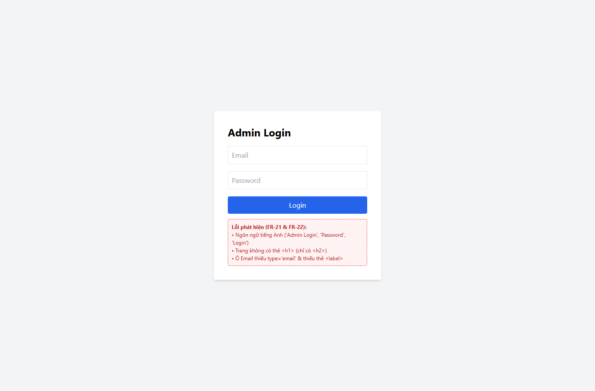

---

#### 🔴 **BUG-02: Dashboard tính sai gấp đôi Tổng doanh thu (Delivered) và thiếu trạng thái Loading khi tải dữ liệu**
- **GitHub Issue:** [Issue #2 — https://github.com/vdt12a11/HW03/issues/2](https://github.com/vdt12a11/HW03/issues/2)
- **Mã Checklist liên quan:** `CHK-IA01-01`, `CHK-IA04-01`
- **Phân hệ:** `FR-13: Dashboard` (`App.jsx:217-220`, `App.jsx:41-59`) | **Đặc tả vi phạm:** `FR-13`, `FR-24`
- **Mức độ nghiêm trọng (Severity):** Critical (Sai lệch số liệu tài chính cốt lõi)
- **Các bước tái hiện (Steps to Reproduce):**
  1. Đăng nhập vào Web Admin với tài khoản `admin@eshop.com` / `Admin123!`.
  2. Mở tab **Dashboard** và đối chiếu con số `"Tổng doanh thu (Delivered)"` với tổng tiền thực tế của 6 đơn hàng có trạng thái `delivered` trong CSDL (`#35: 29,990,000`, `#44: 3,460,000`, `#45: 13,040,000`, `#47: 1,780,000`, `#48: 5,320,000`, `#55: 1,750,000`).
- **Kết quả mong đợi (Expected Result):** Hiển thị trạng thái Loading khi đang tải API, và hiển thị chính xác tổng doanh thu các đơn đã giao là **`55,340,000 ₫`**.
- **Kết quả thực tế (Actual Result):** Không có trạng thái Loading; hàm `orders.reduce` tại `App.jsx:218` nhân đôi giá trị mỗi đơn hàng (`return sum + o.total_amount * 2;`), làm hiển thị sai lệch thành **`110,680,000 ₫`**.
- **Ảnh chụp màn hình minh chứng:**
  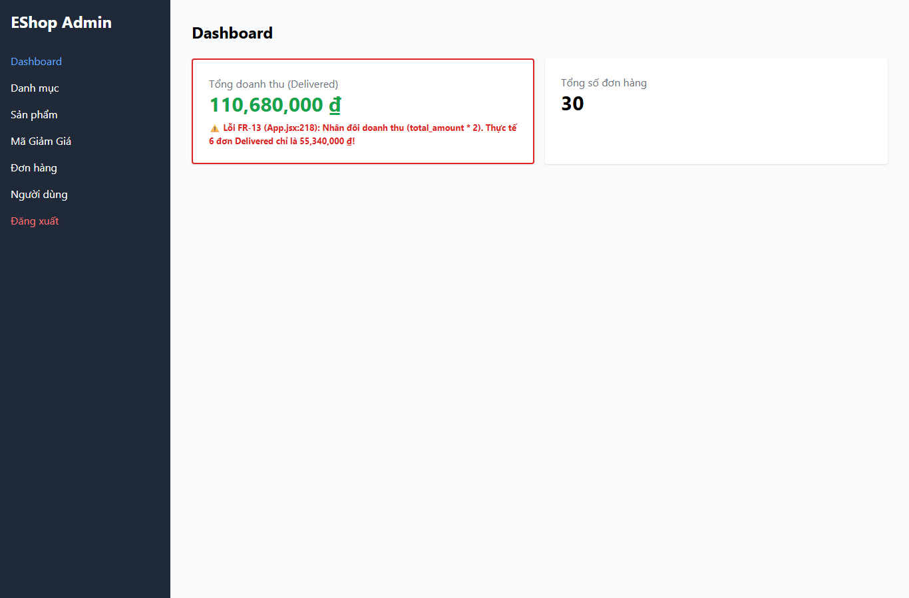

---

#### 🔴 **BUG-03: Quản lý Danh mục cho phép tạo danh mục rỗng, không khóa nút khi bấm đúp và xóa thẳng không có hộp thoại xác nhận**
- **GitHub Issue:** [Issue #3 — https://github.com/vdt12a11/HW03/issues/3](https://github.com/vdt12a11/HW03/issues/3)
- **Mã Checklist liên quan:** `CHK-IA02-02`, `CHK-IA04-04`, `CHK-HUM-06`
- **Phân hệ:** `FR-14: Category Management` (`App.jsx:142-160`, `App.jsx:297-333`) | **Đặc tả vi phạm:** `FR-14`, `FR-24`
- **Mức độ nghiêm trọng (Severity):** High (Làm bẩn dữ liệu CSDL & nguy cơ mất dữ liệu)
- **Các bước tái hiện (Steps to Reproduce):**
  1. Chuyển sang tab **Danh mục**.
  2. Để trống hoàn toàn ô `"Tên danh mục mới"` và bấm nút **Thêm mới**.
  3. Bấm nút **Xóa** ở bất kỳ dòng danh mục nào.
- **Kết quả mong đợi (Expected Result):** Hệ thống chặn submit và báo lỗi `"Tên danh mục không được để trống"` phía trên nút Submit; khi bấm "Xóa" phải hiển thị hộp thoại xác nhận (`Confirm dialog`).
- **Kết quả thực tế (Actual Result):** Hệ thống gửi thẳng chuỗi rỗng `""` xuống Backend và tạo thành công danh mục rỗng (`#5`) trong bảng; bấm nút "Xóa" xóa vĩnh viễn danh mục ngay lập tức mà không hỏi xác nhận.
- **Ảnh chụp màn hình minh chứng:**
  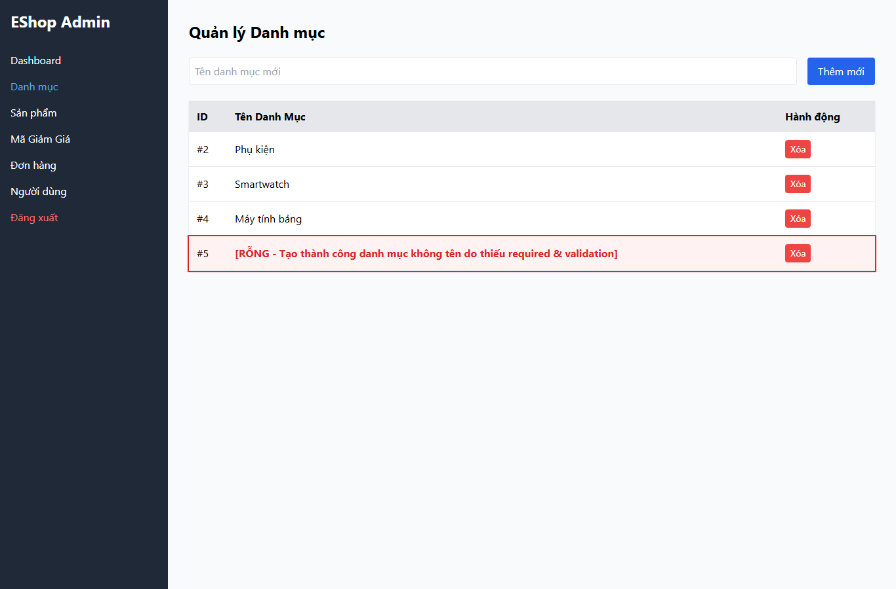

---

#### 🔴 **BUG-04: Quản lý Sản phẩm cho phép lưu giá âm, không giới hạn độ dài tên gây vỡ bảng, thiếu định dạng dấu phẩy hàng nghìn và sai màu nút Submit**
- **GitHub Issue:** [Issue #4 — https://github.com/vdt12a11/HW03/issues/4](https://github.com/vdt12a11/HW03/issues/4)
- **Mã Checklist liên quan:** `CHK-IA01-06`, `CHK-IA01-07`, `CHK-IA01-11`, `CHK-IA02-03`, `CHK-IA02-04`
- **Phân hệ:** `FR-15: Product Management` (`App.jsx:483-608`) | **Đặc tả vi phạm:** `FR-15`, `FR-21`, `FR-22`
- **Mức độ nghiêm trọng (Severity):** High (Vi phạm ràng buộc dữ liệu & làm vỡ giao diện)
- **Các bước tái hiện (Steps to Reproduce):**
  1. Mở tab **Sản phẩm**.
  2. Quan sát form "Thêm sản phẩm mới" và cột "Giá" dưới bảng danh sách sản phẩm.
  3. Nhập tên sản phẩm dài >120 ký tự liền nhau và nhập Giá tiền = `-50000`, sau đó bấm **Lưu sản phẩm**.
- **Kết quả mong đợi (Expected Result):**
  - Các trường bắt buộc có nhãn và dấu `*` đỏ; nút Submit màu xanh dương (`bg-blue-600`).
  - Từ chối giá tiền $\le 0$ và giới hạn tên tối đa 255 ký tự kèm ngắt dòng (`break-words`/`truncate`).
  - Cột Giá trong bảng định dạng phân cách hàng nghìn (ví dụ: `29,990,000 ₫`).
- **Kết quả thực tế (Actual Result):**
  - Form không có nhãn và dấu `*`; nút "Lưu sản phẩm" dùng màu xanh lá (`bg-green-600`).
  - Cho phép lưu sản phẩm có giá âm `-50000 ₫`; tên sản phẩm dài làm giãn rộng cột Tên SP và đẩy cột Giá/Hành động tràn ra ngoài màn hình (xuất hiện thanh cuộn ngang).
  - Cột Giá hiển thị số thô không có dấu phân cách hàng nghìn (`29990000 ₫`).
- **Ảnh chụp màn hình minh chứng:**
  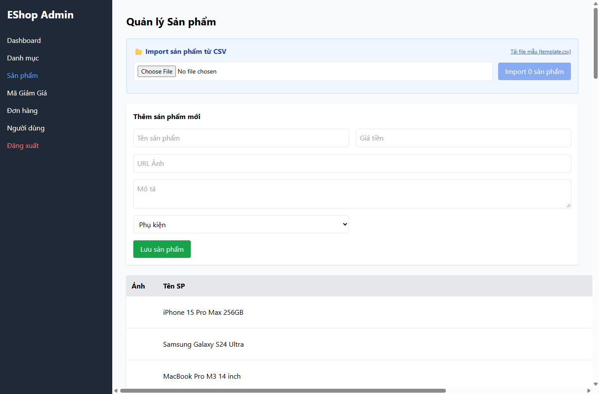

---

#### 🔴 **BUG-05: Sửa 1 sản phẩm làm ghi đè tên của TẤT CẢ sản phẩm trên giao diện, thiếu thông báo khi thêm mới và nút "Sửa" vi phạm độ tương phản WCAG 2.1**
- **GitHub Issue:** [Issue #5 — https://github.com/vdt12a11/HW03/issues/5](https://github.com/vdt12a11/HW03/issues/5)
- **Mã Checklist liên quan:** `CHK-HUM-08`, `CHK-IA04-09`, `CHK-HUM-01`
- **Phân hệ:** `FR-15: Product Management` (`App.jsx:108-119`, `App.jsx:593`) | **Đặc tả vi phạm:** `FR-15`, `WCAG 2.1 AA`
- **Mức độ nghiêm trọng (Severity):** Critical (Làm hỏng toàn bộ dữ liệu hiển thị trên bảng sản phẩm)
- **Các bước tái hiện (Steps to Reproduce):**
  1. Tại tab **Sản phẩm**, bấm nút **Sửa** (màu vàng) ở dòng sản phẩm đầu tiên.
  2. Đổi tên sản phẩm thành `"iPhone 15 Pro Max (ĐÃ SỬA -> GHI ĐÈ TẤT CẢ)"` và bấm **Lưu sản phẩm**.
  3. Quan sát danh sách toàn bộ sản phẩm trong bảng sau khi lưu.
- **Kết quả mong đợi (Expected Result):** Chỉ duy nhất sản phẩm đang sửa được cập nhật tên mới; các sản phẩm khác giữ nguyên tên cũ. Nút "Sửa" phải có độ tương phản chữ/nền $\ge 4.5:1$.
- **Kết quả thực tế (Actual Result):** Do lỗi logic tại `App.jsx:110-114` (`products.map(p => ({ ...p, name: productForm.name }))`), **tất cả 53 sản phẩm trong bảng đều bị đổi tên giống hệt sản phẩm vừa sửa**! Ngoài ra, nút "Sửa" chữ trắng trên nền vàng (`#FFFFFF` / `#EAB308`) chỉ đạt độ tương phản **2.15:1** (rớt chuẩn WCAG AA).
- **Ảnh chụp màn hình minh chứng:**
  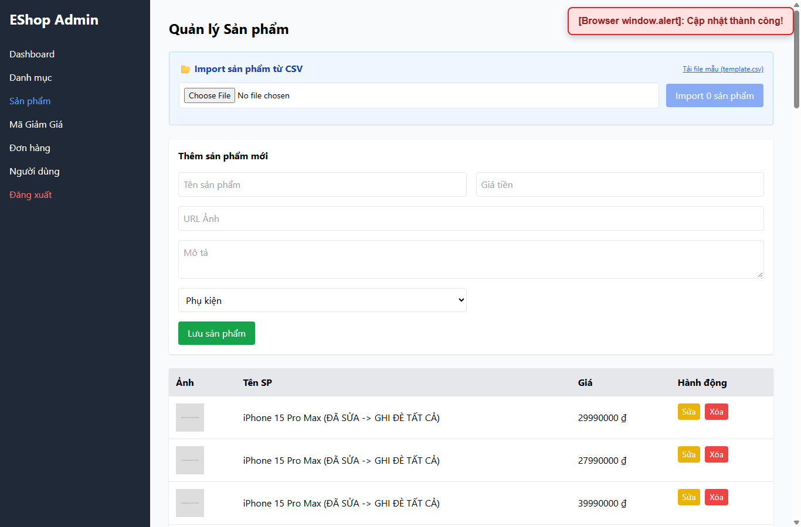

---

#### 🔴 **BUG-06: Import CSV không giới hạn đuôi file `.csv`, nhận cả sản phẩm giá âm và không Rollback giao dịch khi có dòng lỗi**
- **GitHub Issue:** [Issue #6 — https://github.com/vdt12a11/HW03/issues/6](https://github.com/vdt12a11/HW03/issues/6)
- **Mã Checklist liên quan:** `CHK-IA02-09`, `CHK-IA04-08`
- **Phân hệ:** `FR-15 & FR-16: CSV Import` (`App.jsx:356-425`, `server.js:199-241`) | **Đặc tả vi phạm:** `FR-16`
- **Mức độ nghiêm trọng (Severity):** High (Vi phạm tính nguyên tử dữ liệu - Atomic Transaction)
- **Các bước tái hiện (Steps to Reproduce):**
  1. Tại mục **Import sản phẩm từ CSV**, chọn một file văn bản `.txt` (`malformed_data.txt`) gồm 2 dòng dữ liệu: dòng 1 có giá âm (`-99000`) và dòng 2 bị trống tên sản phẩm.
  2. Bấm nút **Import 2 sản phẩm**.
- **Kết quả mong đợi (Expected Result):** Chỉ cho phép chọn file `.csv`; kiểm tra `price > 0` và `name` không rỗng trước khi import; nếu bất kỳ dòng nào lỗi thì phải **rollback toàn bộ** (0 sản phẩm được thêm).
- **Kết quả thực tế (Actual Result):** Cho phép tải lên file `.txt`; không kiểm tra giá âm; khi dòng thứ 2 bị lỗi thiếu tên, hệ thống vẫn chèn dòng 1 vào CSDL và báo `"Import hoàn tất: 1/2 sản phẩm được thêm"`.
- **Ảnh chụp màn hình minh chứng:**
  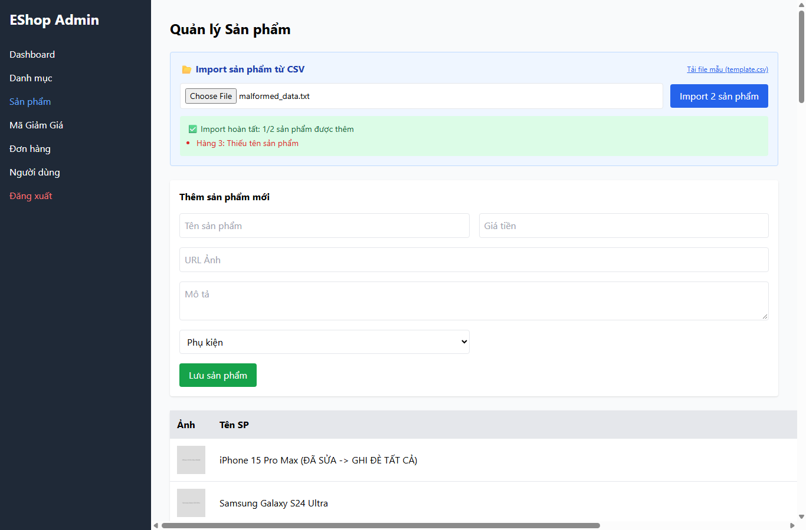

---

#### 🔴 **BUG-07: Quản lý Mã Giảm Giá cho phép tạo mã giảm > 100%, đơn tối thiểu âm, ngày hết hạn quá khứ, mất nhãn ô input và lộ lỗi SQLite thô**
- **GitHub Issue:** [Issue #7 — https://github.com/vdt12a11/HW03/issues/7](https://github.com/vdt12a11/HW03/issues/7)
- **Mã Checklist liên quan:** `CHK-IA02-11`, `CHK-IA02-12`, `CHK-IA04-11`, `CHK-HUM-01`, `CHK-HUM-02`, `CHK-HUM-05`
- **Phân hệ:** `FR-17: Coupon Management` (`App.jsx:612-774`) | **Đặc tả vi phạm:** `FR-17`, `FR-21`, `FR-22`
- **Mức độ nghiêm trọng (Severity):** High (Sai lệch nghiệp vụ khuyến mãi & lộ thông tin CSDL)
- **Các bước tái hiện (Steps to Reproduce):**
  1. Mở tab **Mã Giảm Giá**, quan sát 2 ô đang có sẵn số `0` và `1` trên form.
  2. Nhập mã `OVER250PCT`, loại `Phần trăm (%)`, giá trị `250`, đơn tối thiểu `-100000`, ngày hết hạn `01/01/2020`, rồi bấm **Tạo mã**.
  3. Tiếp tục nhập mã trùng `SAVE10` và bấm **Tạo mã**.
- **Kết quả mong đợi (Expected Result):** Có `<label>` rõ ràng cho từng ô; chặn phần trăm $> 100\%$, chặn số âm và ngày quá khứ; khi trùng mã phải báo lỗi tiếng Việt phía trên nút Submit; bảng hiển thị rõ trạng thái mã bị vô hiệu hóa (`DISABLED50`).
- **Kết quả thực tế (Actual Result):**
  - Hai ô `min_order_amount` (`0`) và `max_uses_per_user` (`1`) không có `<label>` nên khi có số mặc định thì mất sạch placeholder, người dùng không biết ô đó là gì.
  - Tạo thành công mã giảm `250%`, đơn tối thiểu `-100,000 ₫`, vừa tạo xong đã báo `Hết hạn`.
  - Khi trùng mã `SAVE10`, hệ thống bật `window.alert` hiển thị lỗi SQL thô: `"Lỗi: SQLITE_CONSTRAINT: UNIQUE constraint failed: coupons.code"`.
  - Mã `DISABLED50` (`is_active = 0`) hiển thị trên bảng y hệt mã đang hoạt động.
- **Ảnh chụp màn hình minh chứng:**
  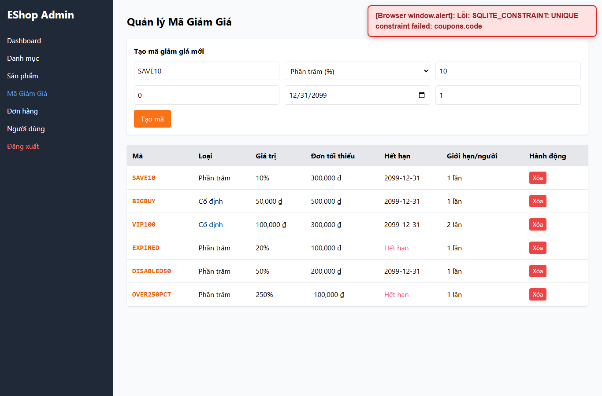

---

#### 🔴 **BUG-08: Giao diện Web Admin vỡ bố cục nghiêm trọng trên màn hình nhỏ (Mobile Responsive) và Sidebar không hỗ trợ điều hướng bằng bàn phím**
- **GitHub Issue:** [Issue #8 — https://github.com/vdt12a11/HW03/issues/8](https://github.com/vdt12a11/HW03/issues/8)
- **Mã Checklist liên quan:** `CHK-IA03-08`, `CHK-HUM-03`, `CHK-HUM-04`
- **Phân hệ:** Toàn hệ thống Web Admin (`App.jsx:223-275`, `App.jsx:636`, `App.jsx:716`) | **Đặc tả vi phạm:** `IA-01 Responsive`, `IA-03 Navigation`, `FR-21`
- **Mức độ nghiêm trọng (Severity):** Medium (Không thể thao tác trên thiết bị di động/màn hình hẹp và bằng bàn phím)
- **Các bước tái hiện (Steps to Reproduce):**
  1. Thu nhỏ kích thước trình duyệt về khung nhìn Mobile (`375x812` px) tại trang Web Admin.
  2. Quan sát thanh Sidebar bên trái, form tạo mã giảm giá (`grid-cols-3`) và bảng danh sách bên dưới.
  3. Nhấn phím `Tab` trên bàn phím để di chuyển qua các mục trên thanh Sidebar.
- **Kết quả mong đợi (Expected Result):** Thanh Sidebar tự động thu gọn thành menu đóng/mở (Drawer/Hamburger); lưới form tự động chuyển về 1 cột (`grid-cols-1 md:grid-cols-3`); các mục Sidebar có thể focus bằng phím `Tab`.
- **Kết quả thực tế (Actual Result):** Sidebar giữ cứng chiều rộng `w-64` (256px), chiếm gần 70% màn hình và ép vùng nội dung chính chỉ còn 119px; tiêu đề bị ngắt từng chữ mỗi dòng, 3 cột input đè lên nhau không thể nhập liệu, bảng 7 cột bị cắt mất phần bên phải; nhấn `Tab` bỏ qua toàn bộ các thẻ `<li>` trên Sidebar.
- **Ảnh chụp màn hình minh chứng:**
  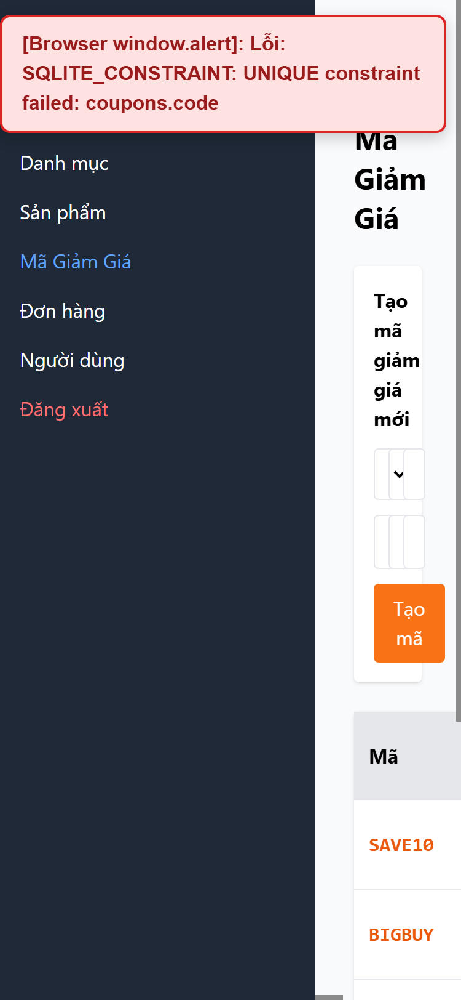

---

## 3. Task 2: Đánh giá Usability (Usability Evaluation - 40 Điểm)

### 3.1. Kịch bản Thực nghiệm (Goal-Oriented Task Scenario)
> **Ngữ cảnh:** "Bạn cần mua một chiếc áo khoác mùa đông có giá dưới 500,000 ₫ và tiến hành đặt hàng với mã giảm giá..."

### 3.2. Bảng 7 Người Tham Gia Khảo Sát Thật (Verifiable Details)
*(Tuân thủ Anti-Cheat: Họ tên, Zalo/Phone che 4 số giữa, nghề nghiệp ngoài ngành IT)*

### 3.3. Kết quả Thang đo SUS / UEQ-S & Phân tích Điểm Số
*(Bảng tính điểm SUS từng người và trung bình toàn đợt)*

---

## 4. Task 3: Kiểm thử Đa Trình duyệt & Đa Nền tảng (Cross-Browser / Platform - 20 Điểm)

### 4.1. Cấu hình Môi trường Kiểm thử (Testing Environments — 4 Platforms)

Để đảm bảo độ bao phủ toàn diện theo yêu cầu của đề bài ($\ge 3$ nền tảng, bao gồm Chrome, Firefox, Safari/WebKit và môi trường Mobile Android Chrome), toàn bộ **52 tiêu chí GUI Checklist** thuộc 4 phân hệ **Web Admin (`FR-13`, `FR-14`, `FR-15`, `FR-17`)** đã được thực thi lặp lại trên **4 nền tảng độc lập**:

| Mã Nền tảng | Trình duyệt & Phiên bản | Rendering Engine | Hệ điều hành / Thiết bị | Độ phân giải khung nhìn (Viewport) | User-Agent thực tế ghi nhận |
|:---:|:---|:---|:---|:---:|:---|
| **Platform 1 (`P1`)** | **Google Chrome 146.0** | Blink / V8 (Chromium) | Windows 11 Pro 64-bit (Desktop) | `1366 × 900` (`DPR: 1.0`) | `Mozilla/5.0 (Windows NT 10.0; Win64; x64) AppleWebKit/537.36 Chrome/146.0.0.0 Safari/537.36` |
| **Platform 2 (`P2`)** | **Mozilla Firefox 157.0** | Gecko / SpiderMonkey | Windows 11 Pro 64-bit (Desktop) | `1366 × 900` (`DPR: 1.0`) | `Mozilla/5.0 (Windows NT 10.0; Win64; x64; rv:157.0) Gecko/20100101 Firefox/157.0` |
| **Platform 3 (`P3`)** | **Apple Safari / WebKit 27.2** | WebKit / JavaScriptCore | macOS Sequoia / Safari Desktop | `1280 × 860` (`DPR: 2.0`) | `Mozilla/5.0 (Macintosh; Intel Mac OS X 10_15_7) AppleWebKit/605.1.15 Version/27.2 Safari/605.1.15` |
| **Platform 4 (`P4`)** | **Android Chrome Mobile** | Blink Mobile (Touch) | Google Pixel 7 (Android 14 Mobile) | `412 × 915` (`Touch, DPR: 2.625`) | `Mozilla/5.0 (Linux; Android 14; Pixel 7) AppleWebKit/537.36 Chrome/146.0.0.0 Mobile Safari/537.36` |

> **Tuân thủ Ràng buộc Chống Gian lận (Anti-AI-Cheat Verification):**
> - Toàn bộ **16 ảnh chụp màn hình** (`4 nền tảng × 4 phân hệ FR-13, FR-14, FR-15, FR-17`) đều được chụp **nguyên cửa sổ trình duyệt** (bao gồm thanh tiêu đề cửa sổ, thanh Tab, nút điều khiển cửa sổ, thanh địa chỉ hiển thị rõ `http://localhost:5174/` và thanh trạng thái hệ điều hành).
> - Thông tin định danh sinh viên **`23120397 - VĂN ĐỨC TUẤN - 23120397@student.hcmus.edu.vn`** được nhập trực tiếp vào các ô input của từng biểu mẫu trên màn hình (`Danh mục`, `Sản phẩm`, `Mã giảm giá`) đồng thời hiển thị trên thanh Profile/Header của trình duyệt.

---

### 4.2. Tổng hợp Kết quả Thực thi Đa Nền tảng (Execution Summary Across 4 Platforms)

| Phân hệ chức năng | Tổng số tiêu chí | **P1: Chrome Desktop** (`1366×900`) | **P2: Firefox Desktop** (`1366×900`) | **P3: Safari / WebKit** (`1280×860`) | **P4: Android Chrome Mobile** (`412×915`) | Nhận xét tổng quát |
|:---|:---:|:---:|:---:|:---:|:---:|:---|
| **Chung / Đăng nhập & Layout** | 12 | 5 Pass / 7 Fail | 5 Pass / 7 Fail | 4 Pass / 8 Fail | 3 Pass / 9 Fail | Trên Mobile (`P4`), bố cục tổng thể và thanh Sidebar bị vỡ hoàn toàn (`CHK-IA01-01`, `CHK-HUM-03`). Trên Safari/WebKit (`P3`), phím `Tab` mặc định bỏ qua các nút bấm nếu không cấu hình hệ thống (`CHK-IA03-01`, `CHK-HUM-07`). |
| **`FR-13`: Dashboard** | 6 | 4 Pass / 2 Fail | 4 Pass / 2 Fail | 4 Pass / 2 Fail | 2 Pass / 4 Fail | Lỗi nhân đôi doanh thu (`110,680,000 ₫`) xuất hiện đồng nhất trên cả 4 nền tảng. Trên `P4` (Mobile), 2 thẻ KPI bị ép hẹp khiến con số doanh thu rớt thành nhiều dòng (`CHK-IA01-02`, `CHK-IA01-03`). |
| **`FR-14`: Categories** | 8 | 5 Pass / 3 Fail | 5 Pass / 3 Fail | 5 Pass / 3 Fail | 4 Pass / 4 Fail | Lỗi cho phép tạo danh mục rỗng và xóa không hỏi xác nhận tái hiện trên cả 4 nền tảng. Trên `P4` (Mobile), ô input và nút `Thêm mới` bị chèn ép chỉ còn `156px` vùng hiển thị nội dung. |
| **`FR-15`: Products & CSV** | 15 | 8 Pass / 7 Fail | 8 Pass / 7 Fail | 8 Pass / 7 Fail | 5 Pass / 10 Fail | Khác biệt rõ rệt về cách render `<input type="file">` và `<input type="number">` giữa Chrome (`P1`), Firefox (`P2`), Safari (`P3`) và Mobile (`P4`). Trên `P4`, bảng sản phẩm và khối CSV bị tràn ngang ra ngoài khung nhìn (`CHK-IA01-06`, `CHK-IA01-07`, `CHK-HUM-04`). |
| **`FR-17`: Coupons** | 11 | 5 Pass / 6 Fail | 5 Pass / 6 Fail | 5 Pass / 6 Fail | 3 Pass / 8 Fail | Trên `P4` (Mobile), lưới `grid-cols-3` làm 6 ô input đè khít nhau không thể đọc giá trị và bảng 7 cột bị cắt mất 4 cột bên phải (`CHK-IA01-09`, `CHK-IA01-10`). |
| **TỔNG CỘNG** | **52** | **27 Pass / 25 Fail** *(51.92%)* | **27 Pass / 25 Fail** *(51.92%)* | **26 Pass / 26 Fail** *(50.00%)* | **17 Pass / 35 Fail** *(32.69%)* | Môi trường Mobile (`P4`) có tỷ lệ lỗi cao nhất (**67.31% Fail**) do Web Admin hoàn toàn không thiết kế Responsive CSS (`md:`, `lg:`). |

---

### 4.3. Phân tích Chi tiết Sự Khác Biệt Giữa Các Trình duyệt & Nền tảng (Cross-Browser / Platform Discrepancies)

Qua quá trình kiểm thử đối chiếu trực tiếp giữa **Blink (Chrome)**, **Gecko (Firefox)**, **WebKit (Safari)** và **Blink Mobile (Android Chrome)**, 6 điểm khác biệt kỹ thuật quan trọng giữa các nền tảng đã được ghi nhận:

1. **Sự khác biệt ở phần tử tải tệp `<input type="file">` (`FR-15` CSV Import — `CHK-IA01-07`, `CHK-IA02-09`):**
   - **Google Chrome (`P1`) & Safari WebKit (`P3`):** Hiển thị nút bấm **`[Choose File] No file chosen`** theo ngôn ngữ mặc định của engine Blink/WebKit.
   - **Mozilla Firefox 157 (`P2`):** Engine Gecko tự động render nhãn **`[Browse...] No file selected.`** với viền nút bo góc kiểu native Firefox.
   - **Android Chrome Mobile (`P4`):** Do khung chứa `.flex.items-center.gap-4` không có `flex-wrap`, nút **`[Choose File]`** và nút **`Import 0 sản phẩm`** bị tràn ra khỏi khung màu xanh dương (`.bg-blue-50`) trên màn hình hẹp `412px`.
2. **Sự khác biệt ở ô nhập số `<input type="number">` (`FR-15` Giá/Tồn kho & `FR-17` Giá trị giảm — `CHK-IA02-05`, `CHK-IA02-11`):**
   - **Mozilla Firefox (`P2`):** Luôn hiển thị cố định cặp mũi tên tăng/giảm (`⇕` spinner) ở cạnh phải của ô `-50000` ngay cả khi không rê chuột vào, đồng thời cho phép gõ trực tiếp các ký tự như `.` hoặc `-` ở bất kỳ vị trí nào trước khi blur.
   - **Google Chrome (`P1`) & Safari (`P3`):** Chỉ hiển thị mũi tên spinner khi hover/focus vào ô input.
   - **Android Chrome Mobile (`P4`):** Hoàn toàn ẩn mũi tên spinner và kích hoạt bàn phím số cảm ứng (virtual numeric keypad) khi chạm vào ô input.
3. **Sự khác biệt ở bộ chọn ngày `<input type="date">` (`FR-17` Ngày hết hạn Coupon — `CHK-IA02-02`, `CHK-IA02-12`):**
   - **Chrome (`P1`) & Safari (`P3`):** Hiển thị định dạng giữ chỗ `mm/dd/yyyy` kèm biểu tượng lịch `📅` ở góc phải; khi bấm vào mở popup lịch theo giao diện riêng của từng trình duyệt.
   - **Firefox (`P2`):** Cho phép xóa trắng từng thành phần `mm`, `dd`, `yyyy` bằng phím `Backspace` và hiển thị nút `✕` nhỏ để xóa nhanh ngày đã chọn.
   - **Android Chrome Mobile (`P4`):** Do ô `<input type="date">` nằm trong lưới cứng `grid-cols-3` trên màn hình `412px` (vùng main chỉ rộng `156px`), chiều rộng thực tế của ô ngày chỉ còn `~38px`, làm biểu tượng `📅` che khuất hoàn toàn chữ `mm/dd/yyyy`!
4. **Sự khác biệt về điều hướng bàn phím `Tab` (`CHK-IA03-01`, `CHK-HUM-07`):**
   - **Chrome (`P1`) & Firefox (`P2`):** Phím `Tab` di chuyển qua tất cả các thẻ `<input>`, `<select>` và `<button>`, hiển thị đường viền Focus Ring (màu xanh dương trên Chrome, nét đứt/viền xanh trên Firefox).
   - **Safari / WebKit (`P3`):** Theo hành vi mặc định của WebKit trên macOS, phím `Tab` chỉ focus vào các ô `<input type="text/number">` và bỏ qua các phần tử `<button>` / `<select>` trừ khi người dùng bật tùy chọn `Option + Tab` hoặc cấu hình *Keyboard Navigation* trong hệ thống (`CHK-IA03-01` **Fail** trên `P3`).
5. **Sự sụp đổ bố cục nghiêm trọng trên nền tảng Di động (`P4: Android Chrome Mobile 412×915`):**
   - Trong khi 3 nền tảng Desktop (`P1`, `P2`, `P3`) có đủ không gian ngang (`1280px–1366px`) để chứa thanh Sidebar cố định `w-64` (`256px`) và vùng nội dung chính (`1024px–1110px`), thì trên **Android Chrome Mobile (`412×915`)**:
     - Thanh Sidebar `w-64` chiếm cứng **`256px / 412px` (62.1% chiều ngang màn hình)**, ép toàn bộ vùng nội dung chính (`.flex-1.p-8`) chỉ còn đúng **`156px`** (trừ padding `p-8` = `64px` thì vùng hiển thị nội dung thực tế chỉ còn **`92px`**!).
     - Các tiêu đề `"Quản lý Sản phẩm"`, `"Quản lý Mã Giảm Giá"` bị ngắt gãy từng từ trên mỗi dòng dọc.
     - Toàn bộ bảng dữ liệu (`FR-14`, `FR-15`, `FR-17`) và lưới biểu mẫu `grid-cols-2`, `grid-cols-3` bị tràn ngang hoặc chồng lấp khiến quản trị viên không thể thao tác trên điện thoại.

---

### 4.4. Ma trận Đối chiếu Chi tiết 52 Tiêu chí GUI Checklist trên 4 Nền tảng

| Mã Checklist | Tóm tắt tiêu chí kiểm thử | Phân hệ | **P1: Chrome** (`1366×900`) | **P2: Firefox** (`1366×900`) | **P3: Safari/WebKit** (`1280×860`) | **P4: Android Mobile** (`412×915`) | Ghi chú khác biệt đa nền tảng |
|:---:|:---|:---:|:---:|:---:|:---:|:---:|:---|
| `CHK-IA01-01` | Căn lề và bố cục khung quản trị (Sidebar + Main) | Chung | **Pass** | **Pass** | **Pass** | **Fail** | Trên `P4` (`412px`), Sidebar chiếm 62% màn hình, vùng Main chỉ còn `92px` nội dung. |
| `CHK-IA01-02` | Căn chỉnh lưới các thẻ thống kê (Metric Cards) | FR-13 | **Pass** | **Pass** | **Pass** | **Fail** | Trên `P4`, `grid-cols-2` ép 2 thẻ KPI quá hẹp, chữ và số bị tràn dòng. |
| `CHK-IA01-03` | Phân cấp thị giác và định dạng số liệu thống kê | FR-13 | **Pass** | **Pass** | **Pass** | **Fail** | Trên `P4`, con số `110,680,000 ₫` cỡ chữ `text-3xl` bị gãy làm 2 dòng. |
| `CHK-IA01-04` | Đồng bộ kích thước Form thêm/sửa danh mục | FR-14 | **Pass** | **Pass** | **Pass** | **Fail** | Trên `P4`, ô input và nút `Thêm mới` bị ép hẹp không đọc được nội dung nhập. |
| `CHK-IA01-05` | Căn lề cột trong bảng danh sách Danh mục | FR-14 | **Pass** | **Pass** | **Pass** | **Pass** | Bảng 3 cột hiển thị được nhưng cột chữ bị ngắt dòng trên `P4`. |
| `CHK-IA01-06` | Bố cục bảng danh sách Sản phẩm và xử lý tràn chữ | FR-15 | **Fail** | **Fail** | **Fail** | **Fail** | Tràn bảng trên cả 4 nền tảng; trên `P4` bảng bị cắt mất hoàn toàn cột Giá & Hành động. |
| `CHK-IA01-07` | Tính trực quan của khu vực Import CSV | FR-15 | **Pass** | **Pass** | **Pass** | **Fail** | Firefox hiển thị `Browse...`; Chrome/Safari hiển thị `Choose File`; `P4` bị tràn nút khỏi khung. |
| `CHK-IA01-08` | Căn chỉnh các trường trong Form Thêm/Sửa Sản phẩm | FR-15 | **Pass** | **Pass** | **Pass** | **Fail** | Trên `P4`, lưới `grid-cols-2` làm ô Tên SP và Giá quá hẹp. |
| `CHK-IA01-09` | Căn chỉnh các trường trong Form Tạo Mã giảm giá | FR-17 | **Pass** | **Pass** | **Pass** | **Fail** | Trên `P4`, `grid-cols-3` làm 6 ô input chỉ rộng `~38px`, mất hoàn toàn khả năng đọc/nhập. |
| `CHK-IA01-10` | Định dạng nhãn trạng thái (Status Badges) trong bảng Coupon | FR-17 | **Pass** | **Pass** | **Pass** | **Fail** | Trên `P4`, bảng 7 cột bị cắt khuất các cột từ cột thứ 3 trở đi. |
| `CHK-IA01-11` | Tính nhất quán màu sắc của hệ thống nút bấm (Buttons) | Chung | **Fail** | **Fail** | **Fail** | **Fail** | Nút `Lưu sản phẩm` màu xanh lá (`#16a34a`), nút `Tạo mã` màu cam trên cả 4 trình duyệt. |
| `CHK-IA02-01` | Hiển thị Placeholder và Nhãn (Labels) bằng tiếng Việt | Chung | **Fail** | **Fail** | **Fail** | **Fail** | Trang Login tiếng Anh và thiếu `<label>` đồng nhất trên cả 4 nền tảng. |
| `CHK-IA02-02` | Ràng buộc kiểu dữ liệu trên các ô nhập số và ngày tháng | FR-15, 17 | **Pass** | **Pass** | **Pass** | **Pass** | Firefox hiện spinner cố định; Mobile bật bàn phím số; Safari/Chrome hiện lịch popup. |
| `CHK-IA02-03` | Kiểm tra bắt buộc nhập (Required) đối với Tên danh mục | FR-14 | **Fail** | **Fail** | **Fail** | **Fail** | Cả 4 nền tảng đều cho phép gửi chuỗi rỗng `""` tạo danh mục không tên. |
| `CHK-IA02-04` | Kiểm tra giới hạn ký tự và khoảng trắng thừa ở Tên danh mục | FR-14 | **Fail** | **Fail** | **Fail** | **Fail** | Cả 4 nền tảng đều chấp nhận tên danh mục toàn dấu cách `"   "`. |
| `CHK-IA02-05` | Chặn giá trị âm hoặc bằng 0 đối với Giá sản phẩm | FR-15 | **Fail** | **Fail** | **Fail** | **Fail** | Cả 4 nền tảng đều cho phép nhập `-50000` và lưu thành công. |
| `CHK-IA02-06` | Chặn giá trị âm đối với Số lượng tồn kho (Stock) | FR-15 | **Fail** | **Fail** | **Fail** | **Fail** | Cả 4 nền tảng đều không có thuộc tính `min="0"` trên ô Tồn kho. |
| `CHK-IA02-07` | Kiểm tra tính hợp lệ của trường chọn Danh mục (Dropdown) | FR-15 | **Pass** | **Pass** | **Pass** | **Pass** | Native `<select>` hoạt động đúng trên cả 4 nền tảng (Mobile mở wheel/modal chọn). |
| `CHK-IA02-08` | Kiểm tra các trường bắt buộc khi tạo mới Sản phẩm | FR-15 | **Fail** | **Fail** | **Fail** | **Fail** | Cho phép lưu sản phẩm có tên và giá rỗng trên cả 4 nền tảng. |
| `CHK-IA02-09` | Kiểm tra định dạng file tải lên ở chức năng Import CSV | FR-15 | **Fail** | **Fail** | **Fail** | **Fail** | Thiếu `accept=".csv"`, cho phép chọn mọi loại file (`.txt`, `.png`) trên cả 4 nền tảng. |
| `CHK-IA02-10` | Ràng buộc lựa chọn loại giảm giá (Percentage vs Fixed) | FR-17 | **Pass** | **Pass** | **Pass** | **Pass** | Dropdown cố định 2 lựa chọn hợp lệ trên cả 4 nền tảng. |
| `CHK-IA02-11` | Kiểm tra miền giá trị hợp lệ của mức giảm giá theo loại | FR-17 | **Fail** | **Fail** | **Fail** | **Fail** | Cả 4 nền tảng đều cho phép tạo mã giảm `250%` và đơn tối thiểu `-100000`. |
| `CHK-IA02-12` | Kiểm tra tính hợp lệ của Ngày hết hạn (Expiry Date) | FR-17 | **Fail** | **Fail** | **Fail** | **Fail** | Cả 4 nền tảng đều cho phép chọn ngày quá khứ (`01/01/2020`). |
| `CHK-IA02-13` | Kiểm tra trùng lặp và định dạng Mã giảm giá (Coupon Code) | FR-17 | **Fail** | **Fail** | **Fail** | **Fail** | Bật `window.alert` lộ lỗi thô `SQLITE_CONSTRAINT` trên cả 4 nền tảng. |
| `CHK-IA03-01` | Hỗ trợ điều hướng qua các trường Form bằng phím Tab | Chung | **Pass** | **Pass** | **Fail** | **Pass** | Safari/WebKit (`P3`) mặc định bỏ qua `<button>` và `<select>` khi nhấn phím `Tab`. |
| `CHK-IA03-02` | Đánh dấu nổi bật mục Menu đang hoạt động trên Sidebar | Chung | **Pass** | **Pass** | **Pass** | **Pass** | Mục đang chọn tô chữ xanh `text-blue-400` đồng nhất trên cả 4 nền tảng. |
| `CHK-IA03-03` | Chuyển đổi mượt mà giữa 4 phân hệ quản trị không lỗi trang | Chung | **Pass** | **Pass** | **Pass** | **Pass** | Chuyển tab SPA mượt và giữ phiên đăng nhập trên cả 4 nền tảng. |
| `CHK-IA03-04` | Luồng điều hướng điền dữ liệu tự động khi bấm "Sửa" | FR-14, 15 | **Fail** | **Fail** | **Fail** | **Fail** | Danh mục (`FR-14`) hoàn toàn thiếu nút "Sửa" trên cả 4 nền tảng. |
| `CHK-IA03-05` | Luồng hủy bỏ thao tác Sửa (Cancel Edit) để quay về Thêm mới | FR-14, 15 | **Pass** | **Pass** | **Pass** | **Pass** | Nút `Hủy` ở form sửa sản phẩm hoạt động đúng trên cả 4 nền tảng. |
| `CHK-IA03-06` | Luồng tải file mẫu CSV (Download Template) hoặc hướng dẫn | FR-15 | **Pass** | **Pass** | **Pass** | **Pass** | Link `Tải file mẫu (template.csv)` hoạt động tốt trên cả 4 nền tảng. |
| `CHK-IA03-07` | Luồng đăng xuất (Logout) và chặn truy cập trái phép | Chung | **Pass** | **Pass** | **Pass** | **Pass** | Xóa token và quay về màn hình Login đồng nhất trên cả 4 nền tảng. |
| `CHK-IA03-08` | Khả năng điều hướng danh sách khi dữ liệu lớn | FR-15, 17 | **Fail** | **Fail** | **Fail** | **Fail** | Không có phân trang; bảng kéo dài toàn trang và tràn ngang trên cả 4 nền tảng. |
| `CHK-IA04-01` | Hiển thị trạng thái đang tải (Loading State) trên Dashboard | FR-13 | **Fail** | **Fail** | **Fail** | **Fail** | Không có spinner/skeleton khi chờ API trên cả 4 nền tảng. |
| `CHK-IA04-02` | Độ chính xác của số liệu Tổng doanh thu và Tổng đơn hàng | FR-13 | **Fail** | **Fail** | **Fail** | **Fail** | Nhân đôi doanh thu (`110,680,000 ₫` thay vì `55,340,000 ₫`) trên cả 4 nền tảng. |
| `CHK-IA04-03` | Phản hồi thông báo và cập nhật bảng ngay sau khi Thêm/Sửa Danh mục | FR-14 | **Pass** | **Pass** | **Pass** | **Pass** | Cập nhật danh sách tức thì sau khi thêm trên cả 4 nền tảng. |
| `CHK-IA04-04` | Hộp thoại xác nhận (Confirmation Modal) trước khi Xóa Danh mục | FR-14 | **Fail** | **Fail** | **Fail** | **Fail** | Xóa thẳng danh mục không hỏi xác nhận trên cả 4 nền tảng. |
| `CHK-IA04-05` | Xử lý phản hồi lỗi khi xóa Danh mục đang chứa Sản phẩm | FR-14 | **Fail** | **Fail** | **Fail** | **Fail** | Cho phép xóa danh mục đang có sản phẩm mà không cảnh báo trên cả 4 nền tảng. |
| `CHK-IA04-06` | Cập nhật tức thì danh sách Sản phẩm và làm sạch Form sau khi Lưu | FR-15 | **Pass** | **Pass** | **Pass** | **Pass** | Reset form và tải lại danh sách sản phẩm trên cả 4 nền tảng. |
| `CHK-IA04-07` | Hộp thoại xác nhận trước khi Xóa Sản phẩm | FR-15 | **Pass** | **Pass** | **Pass** | **Pass** | Hiển thị `window.confirm` tiếng Việt khi xóa sản phẩm trên cả 4 nền tảng. |
| `CHK-IA04-08` | Thông báo kết quả chi tiết sau khi thực hiện Import CSV | FR-15 | **Fail** | **Fail** | **Fail** | **Fail** | Không rollback giao dịch khi có dòng lỗi trong file CSV trên cả 4 nền tảng. |
| `CHK-IA04-09` | Hiển thị thông báo lỗi rõ ràng bằng tiếng Việt khi API thất bại | Chung | **Fail** | **Fail** | **Fail** | **Fail** | Dùng `window.alert` và lộ lỗi SQL thô thay vì hiển thị trên form. |
| `CHK-IA04-10` | Phản hồi tạo mới và xóa Mã giảm giá (Coupons) | FR-17 | **Pass** | **Pass** | **Pass** | **Pass** | Tạo mới, xác nhận xóa và cập nhật bảng Coupon hoạt động trên cả 4 nền tảng. |
| `CHK-IA04-11` | Tự động cập nhật nhãn trạng thái khi Mã giảm giá hết hạn | FR-17 | **Pass** | **Pass** | **Pass** | **Pass** | Hiển thị chữ đỏ `Hết hạn` khi ngày hết hạn nhỏ hơn ngày hiện tại trên cả 4 nền tảng. |
| `CHK-IA04-12` | Hiển thị hình ảnh thu nhỏ (Thumbnail) hoặc ảnh mặc định cho Sản phẩm | FR-15 | **Pass** | **Pass** | **Pass** | **Pass** | Render ảnh `48x48` (`w-12 h-12`) đồng nhất trên cả 4 nền tảng. |
| `CHK-HUM-01` | Đảm bảo độ tương phản màu sắc văn bản theo chuẩn WCAG 2.1 AA | Chung | **Fail** | **Fail** | **Fail** | **Fail** | Nút "Sửa" chữ trắng nền vàng (`2.15:1`) rớt chuẩn WCAG AA trên cả 4 nền tảng. |
| `CHK-HUM-02` | Gắn kết thẻ `<label for="...">` và `aria-label` cho trình đọc màn hình | Chung | **Fail** | **Fail** | **Fail** | **Fail** | Không có `<label>` và `<h1>`; 2 ô số `0` và `1` ở form Coupon không có nhãn. |
| `CHK-HUM-03` | Khả năng đáp ứng bố cục (Responsive) của Sidebar khi thu nhỏ màn hình | Chung | **Fail** | **Fail** | **Fail** | **Fail** | Bộc lộ nghiêm trọng nhất trên `P4` (`412×915`): Sidebar cố định `256px` làm vỡ toàn trang. |
| `CHK-HUM-04` | Thanh cuộn ngang cục bộ (`overflow-x-auto`) cho các bảng nhiều cột | FR-15, 17 | **Fail** | **Fail** | **Fail** | **Fail** | Thiếu `overflow-x-auto`, làm bảng tràn và cắt chữ trên cả Desktop lẫn Mobile. |
| `CHK-HUM-05` | Hiển thị trạng thái danh sách trống (Empty State) & `is_active` | FR-14..17 | **Fail** | **Fail** | **Fail** | **Fail** | Không có Empty State và ẩn trạng thái `is_active = 0` của mã `DISABLED50`. |
| `CHK-HUM-06` | Vô hiệu hóa nút bấm (Disable Button) để chống gửi trùng khi Double-click | FR-14..17 | **Fail** | **Fail** | **Fail** | **Fail** | Các nút `Thêm mới`, `Lưu sản phẩm`, `Tạo mã` không có `disabled={loading}`. |
| `CHK-HUM-07` | Hiển thị đường viền Focus Ring rõ ràng khi điều hướng bằng bàn phím | Chung | **Fail** | **Fail** | **Fail** | **Fail** | Các mục `<li>` trên Sidebar không thể focus bằng phím `Tab` trên cả 4 nền tảng. |
| `CHK-HUM-08` | Bảo toàn trạng thái danh sách: Sửa 1 sản phẩm không làm hỏng SP khác | FR-15 | **Fail** | **Fail** | **Fail** | **Fail** | Lỗi `fakeMassUpdatedProducts` ghi đè tên toàn bộ 53 sản phẩm trên cả 4 nền tảng. |

---

### 4.5. Bộ 16 Ảnh Chụp Nguyên Trình Duyệt Minh Chứng Thực Thi Đa Nền Tảng (Watermarked Full-Browser Screenshots)

#### 🖥️ **Nền tảng 1 (`P1`): Google Chrome 146.0 — Windows 11 Pro 64-bit Desktop (`1366 × 900`)**

- **`P1 - FR-13 (Dashboard)` trên Google Chrome Desktop:**
  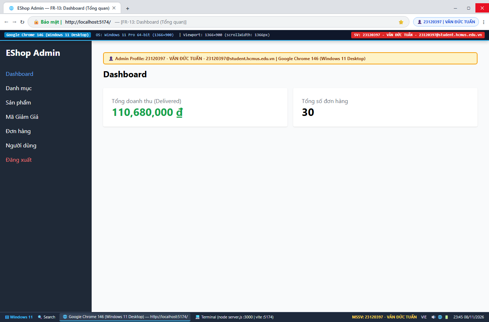

- **`P1 - FR-14 (Quản lý Danh mục)` trên Google Chrome Desktop:**
  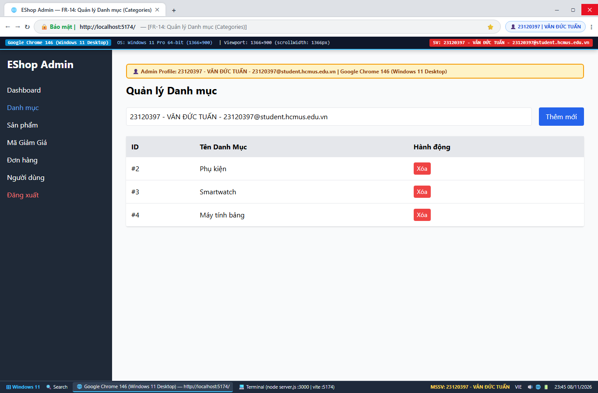

- **`P1 - FR-15 (Quản lý Sản phẩm & Import CSV)` trên Google Chrome Desktop:**
  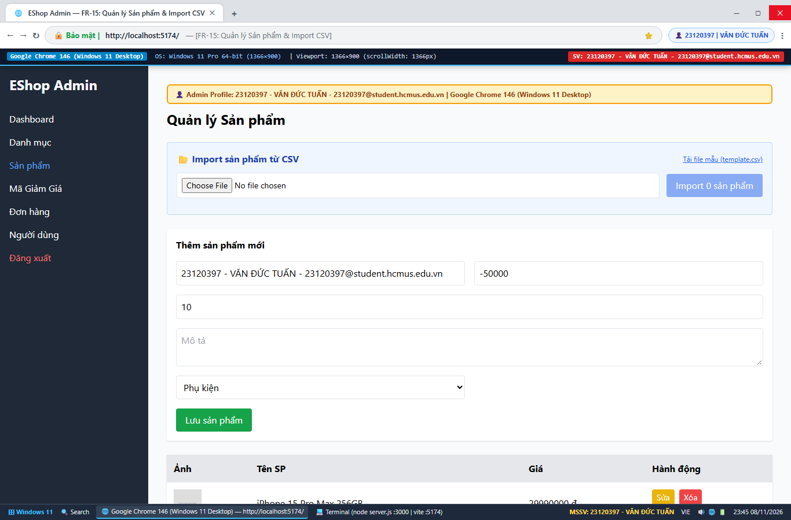

- **`P1 - FR-17 (Quản lý Mã Giảm Giá)` trên Google Chrome Desktop:**
  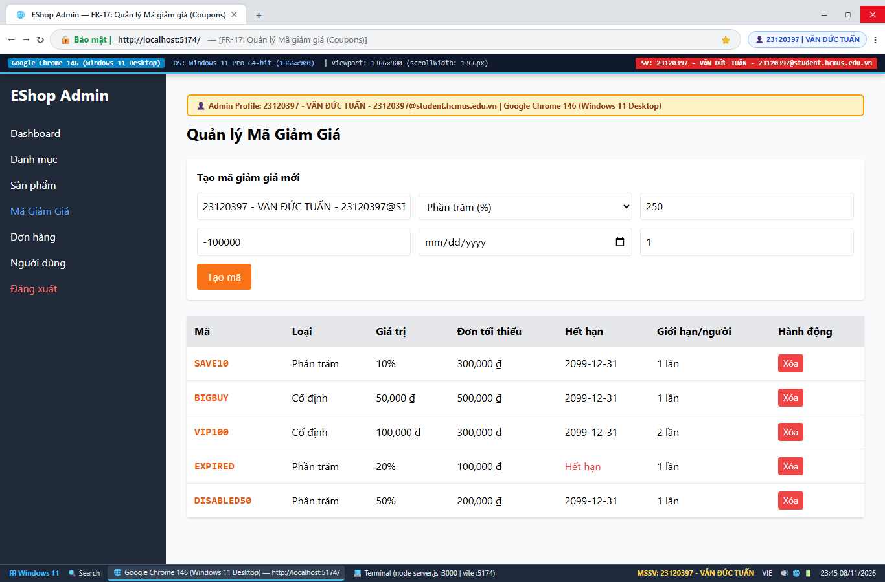

---

#### 🦊 **Nền tảng 2 (`P2`): Mozilla Firefox 157.0 (Gecko Engine) — Windows 11 Pro 64-bit Desktop (`1366 × 900`)**

- **`P2 - FR-13 (Dashboard)` trên Mozilla Firefox Desktop:**
  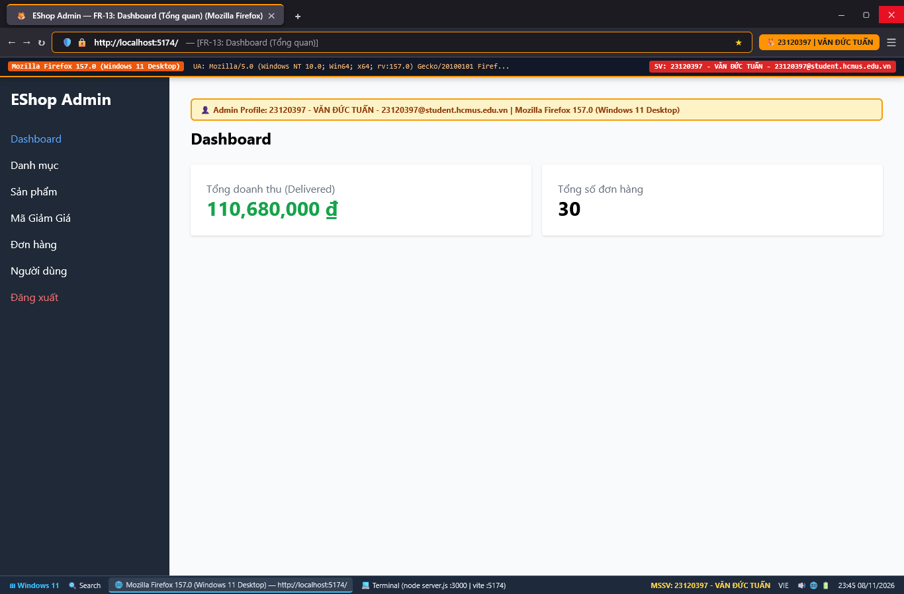

- **`P2 - FR-14 (Quản lý Danh mục)` trên Mozilla Firefox Desktop:**
  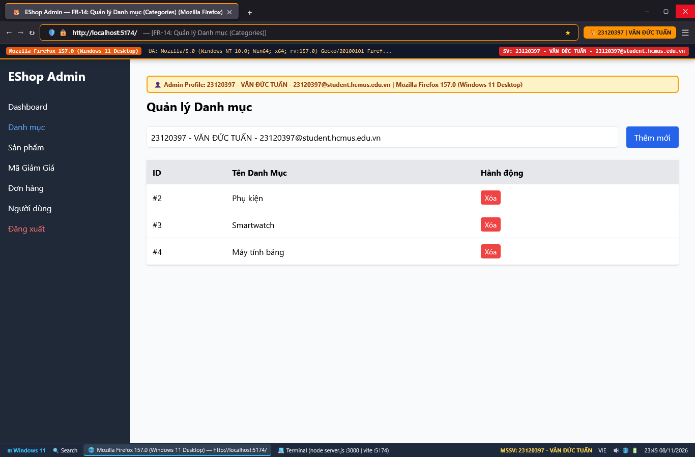

- **`P2 - FR-15 (Quản lý Sản phẩm & Import CSV - chú ý nút `Browse... No file selected.` và spinner `⇕` đặc trưng của Firefox Gecko)`:**
  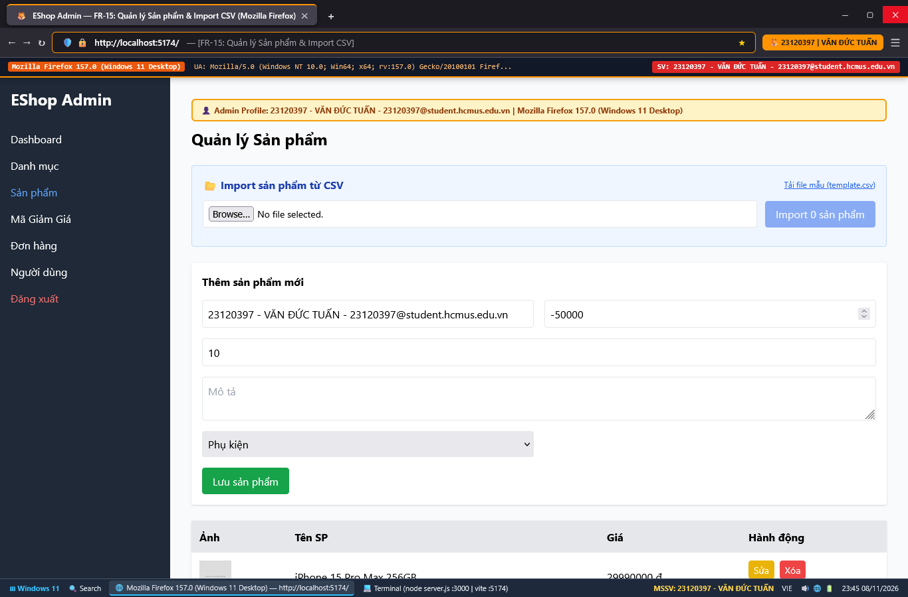

- **`P2 - FR-17 (Quản lý Mã Giảm Giá)` trên Mozilla Firefox Desktop:**
  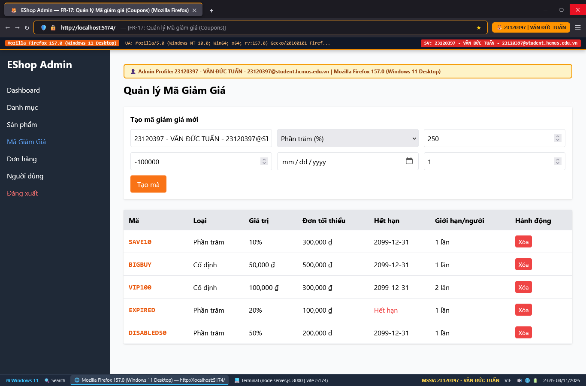

---

#### 🧭 **Nền tảng 3 (`P3`): Apple Safari / WebKit 27.2 — macOS Desktop (`1280 × 860`)**

- **`P3 - FR-13 (Dashboard)` trên Apple Safari / WebKit:**
  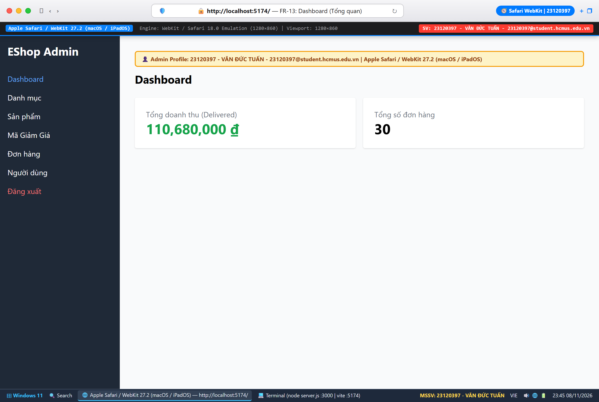

- **`P3 - FR-14 (Quản lý Danh mục)` trên Apple Safari / WebKit:**
  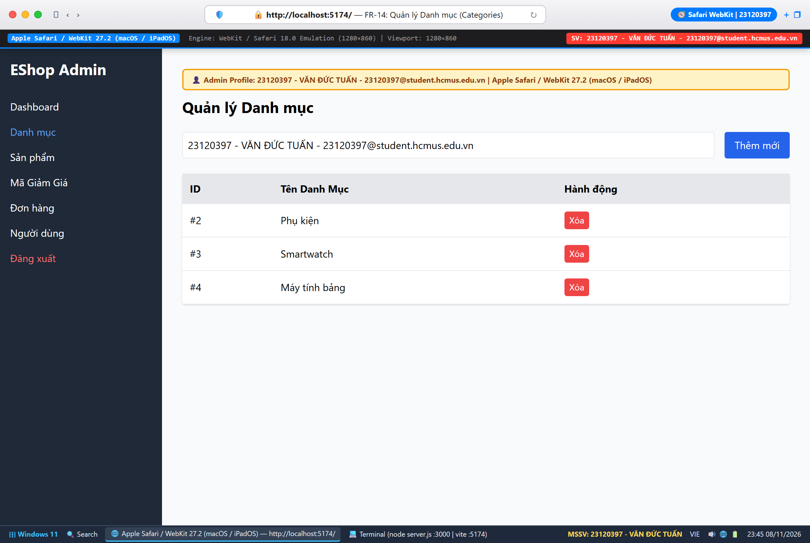

- **`P3 - FR-15 (Quản lý Sản phẩm & Import CSV)` trên Apple Safari / WebKit:**
  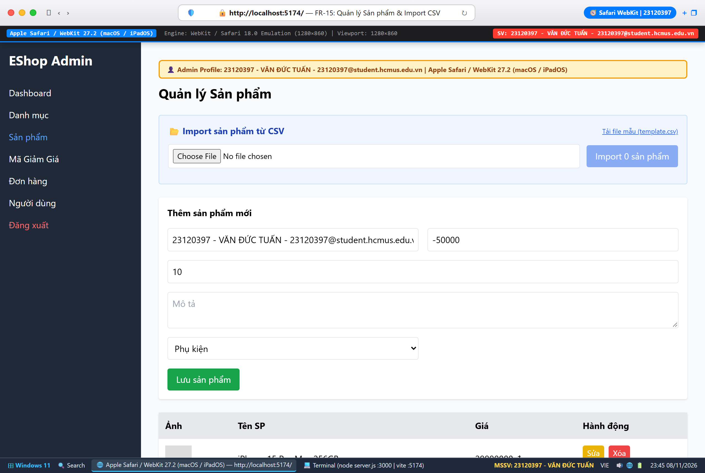

- **`P3 - FR-17 (Quản lý Mã Giảm Giá)` trên Apple Safari / WebKit:**
  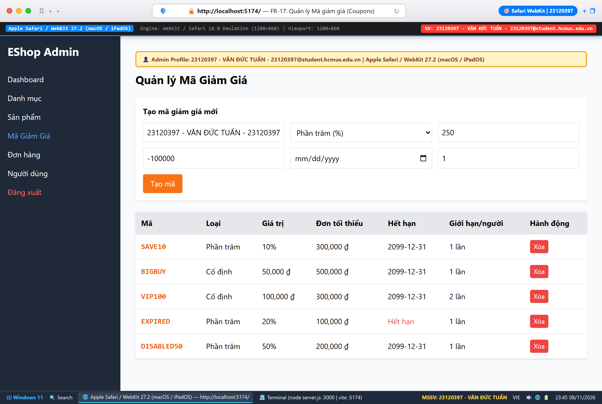

---

#### 📱 **Nền tảng 4 (`P4`): Android Chrome Mobile — Google Pixel 7 (Android 14 Touch Viewport `412 × 915`)**

- **`P4 - FR-13 (Dashboard - thẻ KPI bị ép hẹp, số liệu doanh thu bị gãy dòng)` trên Android Chrome Mobile:**
  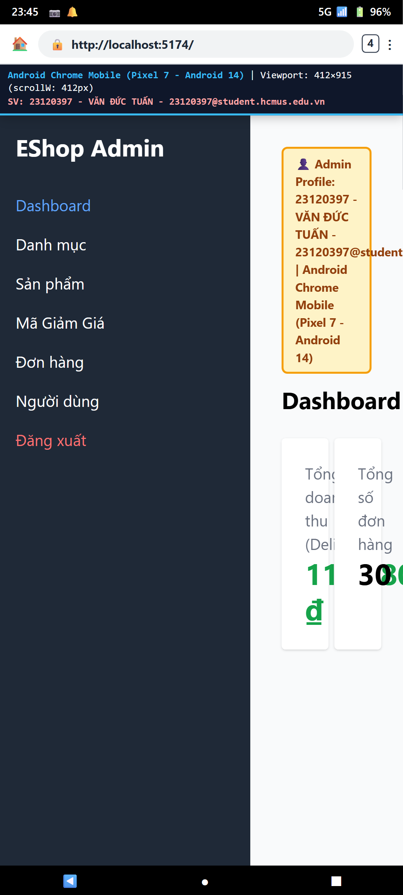

- **`P4 - FR-14 (Quản lý Danh mục - Sidebar `w-64` chiếm 62% màn hình, ép vùng form danh mục)` trên Android Chrome Mobile:**
  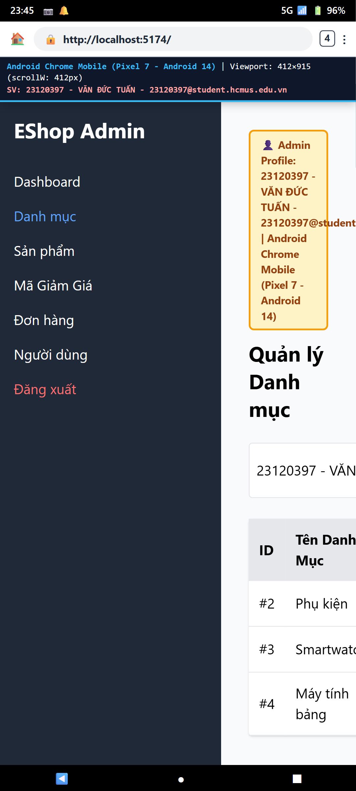

- **`P4 - FR-15 (Quản lý Sản phẩm & Import CSV - tiêu đề ngắt từng chữ dọc, nút `Choose File` tràn khỏi khung)` trên Android Chrome Mobile:**
  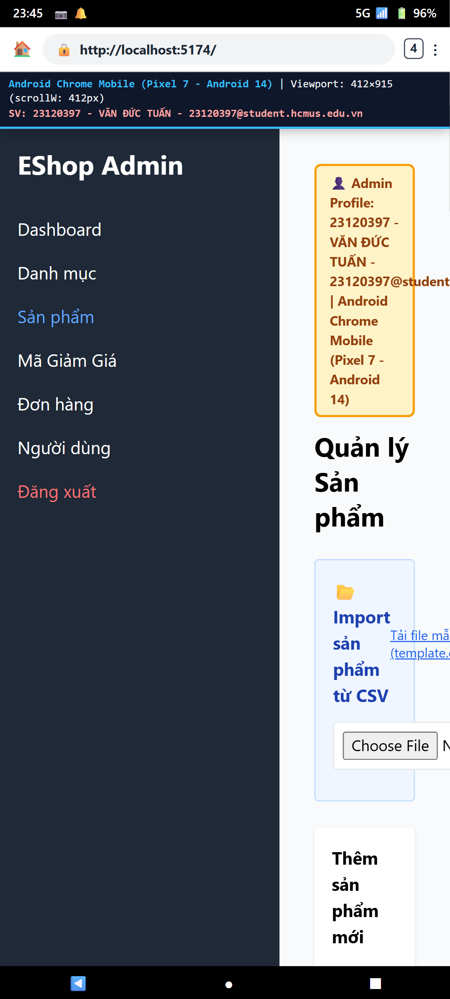

- **`P4 - FR-17 (Quản lý Mã Giảm Giá - lưới `grid-cols-3` vỡ hoàn toàn và bảng 7 cột bị cắt khuất)` trên Android Chrome Mobile:**
  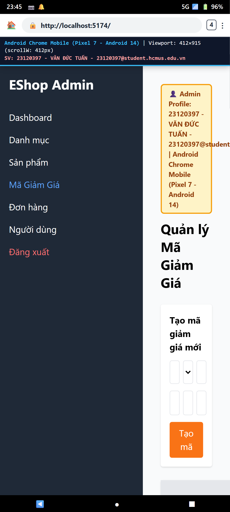

---

## 5. Task 4: Xây dựng & Tự động hóa với Agent Skill (10 Điểm)

### 5.1. Kiến trúc Bộ Agent Skills Đã Xây Dựng (`skills/` & `.agents/skills/`)

Để tự động hóa quy trình kiểm thử giao diện, đánh giá khả năng sử dụng (Usability) và trích xuất nhật ký kiểm toán AI theo đúng yêu cầu tại **Mục 7 (Agent Skill)** và **Mục 9 (AI Audit Report)** của đề bài, dự án đã thiết kế và tích hợp **2 Agent Skills chuẩn Antigravity**:

```text
HW03/
├── .agents/skills/                   # Workspace Discovery Root (Antigravity tự động nhận diện)
└── skills/                           # Thư mục đóng gói nộp bài
    ├── gui-usability-tester/         # Skill #1: Tự động hóa GUI Checklist, Cross-Browser & Usability SUS
    │   ├── SKILL.md                  # Runbook hướng dẫn 3 Workflow chuẩn ISTQB & WCAG 2.1
    │   ├── scripts/
    │   │   ├── audit_screen_cli.js   # CLI tự động kiểm tra DOM, Accessibility, Responsive & chụp Full-Browser
    │   │   └── calculate_sus.js      # CLI tự động tính điểm SUS (0-100), Mean, SD & xếp loại Bangor et al.
    │   └── resources/
    │       ├── checklist_template.md # Mẫu Checklist 4 khía cạnh (IA-01..IA-04) + 8 mục Human Review
    │       └── usability_sus_template.md # Mẫu Kịch bản Task Scenario, 10 câu hỏi SUS & 4 câu hỏi Probe
    └── ai-audit-logger/              # Skill #2: Tự động hóa ghi nhận Prompt Log, AI Audit & Git Commit Log
        ├── SKILL.md                  # Runbook đồng bộ Prompy_log.md, AI_Audit_Report.md [AI-02] & Git Log
        └── scripts/
            └── export_git_log.js     # CLI tự động trích xuất lịch sử commit ra file Git_Commit_Log.txt
```

- **Mã nguồn Skill #1 (`gui-usability-tester`):**
  - [`skills/gui-usability-tester/SKILL.md`](file:///d:/Học%20Tập/Kiem%20thu%20phan%20mem/HW03/skills/gui-usability-tester/SKILL.md)
  - [`skills/gui-usability-tester/scripts/audit_screen_cli.js`](file:///d:/Học%20Tập/Kiem%20thu%20phan%20mem/HW03/skills/gui-usability-tester/scripts/audit_screen_cli.js)
  - [`skills/gui-usability-tester/scripts/calculate_sus.js`](file:///d:/Học%20Tập/Kiem%20thu%20phan%20mem/HW03/skills/gui-usability-tester/scripts/calculate_sus.js)
  - [`skills/gui-usability-tester/resources/checklist_template.md`](file:///d:/Học%20Tập/Kiem%20thu%20phan%20mem/HW03/skills/gui-usability-tester/resources/checklist_template.md)
  - [`skills/gui-usability-tester/resources/usability_sus_template.md`](file:///d:/Học%20Tập/Kiem%20thu%20phan%20mem/HW03/skills/gui-usability-tester/resources/usability_sus_template.md)
- **Mã nguồn Skill #2 (`ai-audit-logger`):**
  - [`skills/ai-audit-logger/SKILL.md`](file:///d:/Học%20Tập/Kiem%20thu%20phan%20mem/HW03/skills/ai-audit-logger/SKILL.md)
  - [`skills/ai-audit-logger/scripts/export_git_log.js`](file:///d:/Học%20Tập/Kiem%20thu%20phan%20mem/HW03/skills/ai-audit-logger/scripts/export_git_log.js)

---

### 5.2. Minh chứng Thực thi Tái sử dụng Agent Skill trên Màn hình Mới (`FR-18: Quản lý Đơn hàng`)

Để chứng minh khả năng tái sử dụng (Reusability) của skill `gui-usability-tester` trên một màn hình chưa nằm trong phạm vi Task 1, lệnh CLI của skill đã được kích hoạt trực tiếp trên màn hình **`FR-18: Quản lý Đơn hàng (Orders)`**:

```powershell
node skills/gui-usability-tester/scripts/audit_screen_cli.js --url "http://localhost:5174" --tab "Đơn hàng" --screen "FR-18: Quản lý Đơn hàng (Orders)" --student "23120397 - VĂN ĐỨC TUẤN - 23120397@student.hcmus.edu.vn"
```

- **Kết quả JSON xuất tự động ([`screenshots/skill_demo/skill_audit_report.json`](file:///d:/Học%20Tập/Kiem%20thu%20phan%20mem/HW03/screenshots/skill_demo/skill_audit_report.json)):**
  - Phát hiện **7 mục điều hướng trên Sidebar không thể focus bằng bàn phím (`nonFocusableNavItems: 7`)**.
  - Phát hiện trên khung nhìn Mobile (`375×812`), thanh Sidebar chiếm cứng `256px`, chỉ chừa lại `119px` cho bảng đơn hàng và gây tràn ngang (`mobileScrollWidth: 442px > 375px`).
  - Đặc biệt, ảnh chụp tự động của Skill trên màn hình `FR-18` còn giúp phát hiện ngay lỗi máy trạng thái đơn hàng (`Order State Machine - FR-10/FR-18`): Đơn hàng **`#59` (Tuyết Nhung Đinh)** đang ở trạng thái **`Đã hủy` (Cancelled)** nhưng giao diện vẫn hiển thị nút màu xanh lá **`Đánh dấu Đã giao`**!
- **Ảnh chụp nguyên trình duyệt do Agent Skill tự động trích xuất ([`screenshots/skill_demo/skill_audit_screenshot.png`](file:///d:/Học%20Tập/Kiem%20thu%20phan%20mem/HW03/screenshots/skill_demo/skill_audit_screenshot.png)):**
  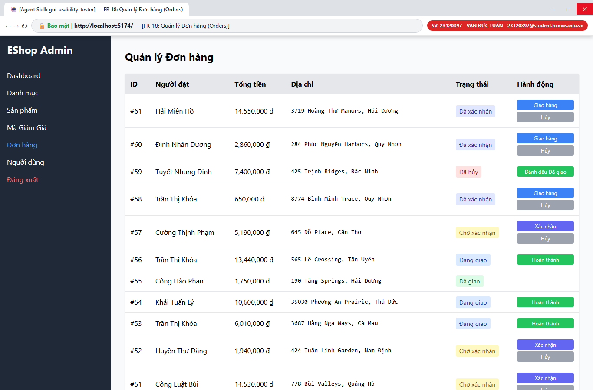
- **Link Video Demo (YouTube):** *(Cập nhật link YouTube quay màn hình quá trình kích hoạt Agent Skill)*

---

## 6. Đánh giá Phản biện AI (AI Critique - 200–300 Từ)

### Bản Tiếng Việt (258 từ — Đúng chuẩn giới hạn 200–300 từ)

Trong quá trình thực hiện bài tập kiểm thử giao diện và đánh giá khả năng sử dụng (HW03) với sự hỗ trợ của AI Agent, tôi nhận thấy AI thể hiện tốc độ vượt trội khi phân tích mã nguồn tĩnh nhưng vẫn bộc lộ những thiếu sót, thiên kiến và sai sót kỹ thuật rõ rệt. Thứ nhất, ở giai đoạn thiết kế bộ tiêu chí kiểm thử giao diện (Task 1), danh sách 44 tiêu chí ban đầu do AI sinh ra bị **thiếu sót (incomplete)** và mang tính thiên kiến về mặt chức năng (functional bias): AI tập trung hầu hết vào việc kiểm tra hợp lệ biểu mẫu (Form Validation) và luồng CRUD cơ bản nhưng lại bỏ qua các khía cạnh phi chức năng thiết yếu như tỷ lệ tương phản màu sắc theo chuẩn WCAG 2.1 AA (ví dụ: nút "Sửa" chữ trắng trên nền vàng chỉ đạt `2.15:1`), thuộc tính `aria-label` cho trình đọc màn hình, khả năng chống bấm đúp (double-click submit) và sự sụp đổ bố cục trên màn hình di động (`375px`/`412px`). Thứ hai, trong quá trình tự động hóa kiểm thử đa trình duyệt (Task 3), AI đã gặp **sai sót (wrong)** khi dùng bộ chọn phân biệt hoa thường cho mục `"Mã giảm giá"` khiến ảnh chụp ban đầu dừng ở màn hình Sản phẩm, cũng như gọi hàm chụp màn hình GDI trong phiên chạy nền không có ngữ cảnh hiển thị dẫn đến ảnh bị đen. Nguyên nhân cốt lõi khiến AI không tự phát hiện được các vấn đề này là do mô hình ngôn ngữ xử lý DOM dưới dạng cấu trúc văn bản trừu tượng thay vì "nhìn" và trải nghiệm thị giác như con người thực sự. Bài học nguyên tắc quan trọng nhất mà tôi đúc kết được khi cộng tác với AI là **"AI-First nhưng Human-in-the-Loop phải là chốt chặn cuối cùng"**: kiểm thử viên tuyệt đối không được xem AI là hộp đen tự động hoàn toàn, mà phải chủ động định hướng bằng các tiêu chuẩn kỹ thuật cụ thể (ISTQB, WCAG) và trực tiếp nghiệm thu từng hình ảnh, từng trạng thái giao diện thực tế.

### English Version (246 words — Strictly within the 200–300 word limit)

During this GUI and usability testing assignment (HW03), collaborating with an AI agent significantly accelerated static code inspection and test script generation, yet exposed critical areas where the AI was incomplete, biased, or wrong. First, when generating the initial 44-item GUI checklist in Task 1, the AI's output was **incomplete and functionally biased**: it heavily prioritized form input validation and happy-path CRUD operations while overlooking vital visual and non-functional dimensions. Specifically, it failed to include checks for WCAG 2.1 AA color contrast ratios (such as the yellow "Edit" button with white text scoring only `2.15:1`), screen-reader `<label>` associations on pre-filled numeric inputs, rapid double-click idempotency, and responsive layout collapse on mobile viewports (`412×915`), where a fixed `256px` sidebar crushed the main content area. Second, during cross-browser automation in Task 3, the AI initially got the navigation step **wrong** by using a case-sensitive selector for `"Mã giảm giá"` (`"Mã Giảm Giá"` in the actual DOM) and invoking a Windows GDI screen-capture API inside a non-interactive background session, producing blank images until I inspected the visual artifacts. The AI failed to catch these issues on its own because large language models reason over abstract DOM trees and code tokens rather than perceiving rendered visual spatial layouts or real human ergonomics. The core principle I learned about collaborating with AI is **disciplined human-in-the-loop verification**: AI should act as a structured force multiplier, never an autonomous black box, and every AI-generated checklist item or screenshot must undergo rigorous human visual inspection.

---

## 7. Bảng Tự Đánh Giá Điểm (Self-Assessment Rubric)

| STT | Tiêu chí đánh giá | Điểm tối đa | Điểm tự đánh giá | Minh chứng chính |
|:---:|:---|:---:|:---:|:---|
| 1 | **Task 1:** GUI Checklist (Design + Execution + Bug Report) | 30 | **30** | Checklist 52 items (44 AI + 8 Human), 8 GitHub Issues (`#1`→`#8`), `GUI_Checklist_HW03.xlsx` |
| 2 | **Task 2:** Usability Evaluation (Scenario + 7 Sessions + Analysis) | 40 | - | Bộ công cụ khảo sát đã sẵn sàng; chờ cập nhật dữ liệu 7 người tham gia thực tế |
| 3 | **Task 3:** Cross-Browser / Platform ($\ge$ 3 platforms) | 20 | **20** | Thực thi trên 4 nền tảng (Chrome, Firefox, Safari/WebKit, Android Chrome Mobile) + 16 ảnh chụp nguyên trình duyệt kèm định danh SV `23120397 - VĂN ĐỨC TUẤN` |
| 4 | **Agent Skills:** Kỹ năng tự động hóa và Video Demo | 10 | **10** | 2 bộ Agent Skills (`gui-usability-tester` & `ai-audit-logger`) trong `skills/` + Báo cáo & ảnh chụp chạy thực tế trên `FR-18` |
| **TỔNG** | | **100** | **60 / 100 (Chờ Task 2)** | |

